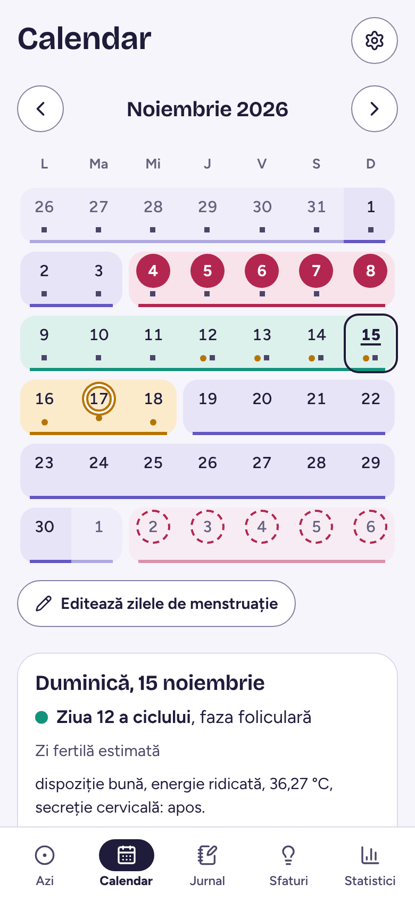
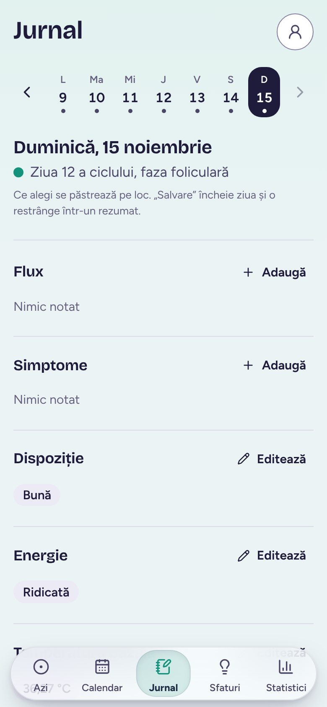
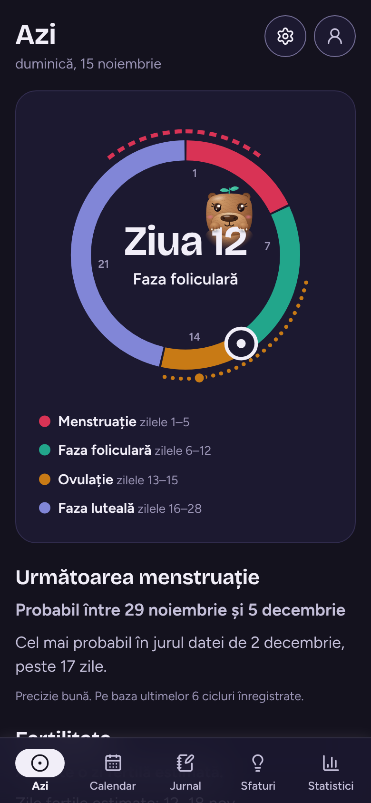

# CycleCare

Prototip web responsive pentru urmărirea ciclului menstrual: jurnal zilnic, calendar pe faze, estimări cu interval, sfaturi, memento-uri, statistici și raport PDF pentru medic. Interfața este în română. Datele rămân criptate pe dispozitiv; nu există cont și nu există server.

Este o aplicație web instalabilă (PWA): se deschide în browserul telefonului și poate fi adăugată pe ecranul principal pe iOS și Android. „CycleCare” este un nume provizoriu.

> CycleCare este un instrument de urmărire și informare. Nu este un dispozitiv medical, nu pune diagnostice și nu poate fi folosit ca metodă de contracepție. Sfaturile și textele juridice sunt schițe: trebuie validate de un medic, respectiv de un jurist, înainte de orice lansare.

<p>




</p>

## Livrabile

| Document                                                                                     | Conținut                                                                              |
| -------------------------------------------------------------------------------------------- | ------------------------------------------------------------------------------------- |
| [docs/01-ecrane-si-navigare.md](docs/01-ecrane-si-navigare.md)                               | Structura ecranelor și fluxul de navigare, cu capturi                                 |
| [docs/02-model-de-date.md](docs/02-model-de-date.md)                                         | Entitățile, relațiile, stocarea criptată și schema relațională                        |
| [docs/03-algoritm-predictie.md](docs/03-algoritm-predictie.md)                               | Algoritmul de predicție, pas cu pas, cu exemple calculate                             |
| [docs/04-sablon-continut-sfaturi.md](docs/04-sablon-continut-sfaturi.md)                     | Sfaturile pe faze și pe simptome și regulile de semnalizare, ca șablon de conținut    |
| [docs/05-consimtamant-si-confidentialitate.md](docs/05-consimtamant-si-confidentialitate.md) | Textele de consimțământ, declarația de confidențialitate și întrebările pentru jurist |

Documentele 4 și 5 sunt generate din conținutul aplicației (`npm run docs:content`), iar un test verifică faptul că sunt la zi: ce scrie în document este exact ce afișează aplicația.

## Pornire

Este nevoie de Node 22 sau mai nou.

```bash
npm install
npm run dev          # aplicația, la http://localhost:5173
```

Pentru a vedea imediat grafice și sfaturi, alege pe primul ecran „Explorează cu date demonstrative”.

| Comandă                    | Ce face                                                                                             |
| -------------------------- | --------------------------------------------------------------------------------------------------- |
| `npm run dev`              | Server de dezvoltare                                                                                |
| `npm run build`            | Verificare de tipuri și build de producție în `dist/` (cu service worker și politică de securitate) |
| `npm run preview`          | Servește build-ul de producție                                                                      |
| `npm run build:single`     | Tot prototipul într-un singur fișier HTML, în `dist-single/`                                        |
| `npm test`                 | Teste unitare (Vitest)                                                                              |
| `npm run test:e2e`         | Teste cap-coadă pe build-ul de producție (Playwright, Chromium)                                     |
| `npm run typecheck`        | Verificare de tipuri                                                                                |
| `npm run format`           | Formatare cu Prettier                                                                               |
| `npm run tokens`           | Regenerează `src/styles/tokens.css` din `tokens.json`                                               |
| `npm run docs:content`     | Regenerează documentele 4 și 5                                                                      |
| `npm run docs:screenshots` | Regenerează capturile (cu build-ul servit pe portul 4173)                                           |

Testele cap-coadă folosesc Chromium-ul instalat de Playwright (`npx playwright install chromium`) sau, dacă există deja unul, calea din variabila `PW_CHROMIUM_PATH`.

## Cum sunt acoperite cerințele

| Cerință                            | În aplicație                                                                                                                                      | Cod                                                                                                    | Teste                                                                     |
| ---------------------------------- | ------------------------------------------------------------------------------------------------------------------------------------------------- | ------------------------------------------------------------------------------------------------------ | ------------------------------------------------------------------------- |
| 1. Onboarding                      | Patru întrebări, fiecare cu „sari peste”; consimțământ explicit, cu două căsuțe nebifate                                                          | `src/screens/Onboarding.tsx`                                                                           | `e2e/onboarding.spec.ts`                                                  |
| 2. Calendar și faze                | Patru faze colorate distinct, zile fertile și ovulație estimate cu avertisment, interval pentru următoarea menstruație, medie mobilă pe 6 cicluri | `src/domain/cycles.ts`, `src/domain/prediction.ts`, `src/screens/Calendar.tsx`, `src/ui/CycleDial.tsx` | `tests/cycles.test.ts`, `tests/prediction.test.ts`, `e2e/journal.spec.ts` |
| 3. Jurnal zilnic                   | Flux, 17 simptome cu intensitate, dispoziție, energie, temperatură bazală, secreție cervicală, note; import de temperaturi din fișier             | `src/screens/Journal.tsx`, `src/domain/importCsv.ts`                                                   | `tests/importCsv.test.ts`, `e2e/journal.spec.ts`, `e2e/data.spec.ts`      |
| 4. Sfaturi personalizate           | Pe faza curentă (alimentație, mișcare, somn, piele), pe simptomele recente, semnalizări pentru simptome neobișnuite sau persistente               | `src/content/ro/tips.ts`, `src/domain/insights.ts`, `src/screens/Tips.tsx`                             | `tests/insights.test.ts`, `tests/docs.test.ts`                            |
| 5. Memento-uri                     | Menstruație, zile fertile, pilulă și alte medicamente; ore, zile și repetare alese de persoană; text discret                                      | `src/domain/reminders.ts`, `src/app/lifecycle.ts`, `src/screens/Settings.tsx`                          | `tests/reminders.test.ts`, `e2e/data.spec.ts`                             |
| 6. Statistici și rapoarte          | Grafice pentru durata ciclurilor, simptome și dispoziție, fiecare cu tabel; raport PDF generat pe dispozitiv                                      | `src/domain/stats.ts`, `src/ui/charts.tsx`, `src/pdf/`                                                 | `tests/stats.test.ts`, `tests/pdf.test.ts`, `e2e/data.spec.ts`            |
| 7. Confidențialitate și securitate | AES-256-GCM în repaus, PIN, biometrie, blocare automată, ștergerea tuturor datelor, nicio partajare                                               | `src/storage/`, `src/app/store.ts`                                                                     | `tests/vault.test.ts`, `e2e/security.spec.ts`, `e2e/quality.spec.ts`      |
| 8. Design și accesibilitate        | Paletă calmă verificată pentru contrast și daltonism, mod întunecat, text scalabil, cititoare de ecran, română cu loc pentru alte limbi           | `src/styles/`, `src/i18n/`                                                                             | `tests/tokens.test.ts`, `e2e/quality.spec.ts`                             |

## Confidențialitate și securitate, pe scurt

- Jurnalul este un document criptat cu AES-256-GCM în IndexedDB. Cheia de date există doar în memorie, cât timp aplicația este deblocată.
- Fără PIN, cheia este păstrată de browser și nu poate fi exportată. Cu PIN, cheia este protejată de o cheie derivată din PIN (PBKDF2-HMAC-SHA-256, 600 000 de iterații); PIN-ul nu este stocat și nu poate fi recuperat.
- Deblocarea biometrică folosește WebAuthn cu extensia PRF: senzorul dispozitivului eliberează un secret care despachetează cheia. Nu se trimite nimic unui server.
- Build-ul de producție are o politică de securitate (`connect-src 'self'`) care împiedică aplicația să comunice cu alt server. Nu există fonturi sau scripturi încărcate de la terți.
- „Șterge toate datele” șterge jurnalul, cheile și preferințele. Retragerea consimțământului face același lucru.

Limitele variantei web sunt descrise deschis în [docs/02-model-de-date.md](docs/02-model-de-date.md): un PIN din cifre are puțină entropie, iar limita de încercări este impusă de aplicație, nu de hardware.

## Ce este diferit față de o aplicație nativă

| Aici                                                                    | Într-o aplicație nativă                                            |
| ----------------------------------------------------------------------- | ------------------------------------------------------------------ |
| Memento-urile apar cât timp aplicația este deschisă și pe ecranul „Azi” | Notificări locale programate în sistem                             |
| Temperaturile se importă dintr-un fișier CSV                            | Citire din Apple Health sau Health Connect                         |
| Cheia este păstrată de browser                                          | Secure Enclave sau StrongBox, cu limită de încercări impusă de cip |

Logica (`src/domain/`), conținutul (`src/content/`), textele (`src/i18n/`) și generatorul PDF (`src/pdf/`) nu depind de browser și pot fi refolosite ca atare. Sunt două drumuri către magazinele de aplicații: împachetarea acestei aplicații web cu Capacitor, cu pluginuri native pentru notificări, biometrie și datele de sănătate, sau o interfață React Native peste aceeași logică.

## Structura codului

```
src/
  domain/      cicluri, predicție, semnalizări, memento-uri, statistici, import CSV (funcții pure)
  storage/     criptare, seif cu sloturi de chei, WebAuthn, export și restaurare
  app/         starea sesiunii, rutare, preferințe, memento-uri în timp real, integrarea cu platforma
  screens/     ecranele
  ui/          controale, ferestre, cadranul ciclului, grafice
  pdf/         cititor TrueType și generator PDF, fără dependențe
  i18n/        texte de interfață și formatare
  content/     sfaturi și texte juridice, pe limbi
  styles/      culori (tokens.json), fonturi, stiluri
tests/         teste unitare
e2e/           teste cap-coadă
scripts/       generatoare: culori, documente, capturi, pictograme, build într-un singur fișier
docs/          livrabilele
```

## Adăugarea unei limbi

1. Copiază `src/i18n/ro.ts` în `src/i18n/<limbă>.ts` și tradu-l; adaugă-l în `dictionaries` din `src/i18n/index.ts`. Verificarea de tipuri semnalează orice text lipsă.
2. Copiază `src/content/ro/` în `src/content/<limbă>/`, tradu textele și înregistrează-le în `src/content/index.ts`.
3. Limba apare în „Setări → Aspect și accesibilitate”.

Pluralul și formatul datelor vin din `Intl`, deci urmează regulile fiecărei limbi.

## Licențe

Fonturile Figtree și Bricolage Grotesque sunt distribuite sub SIL Open Font License 1.1 (textul licenței este lângă fonturile încorporate, în `src/pdf/fonts/OFL.txt`). Pictogramele sunt Lucide (ISC).
