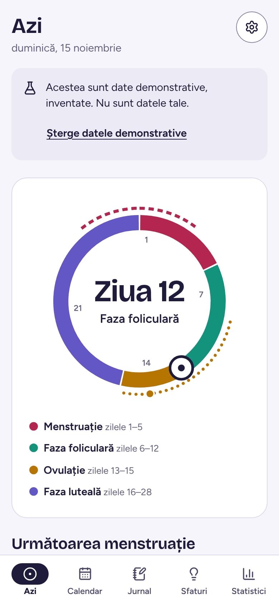

# CycleCare

Aplicație web pentru urmărirea ciclului menstrual: jurnal zilnic, calendar pe faze, estimări cu interval, sfaturi, memento-uri, statistici și raport PDF pentru medic. Interfața este în română și engleză. Datele rămân criptate pe dispozitiv și nu există cont; singura excepție, la alegere, este Modul Partener, criptat cap-coadă.

Este o aplicație web instalabilă (PWA): se deschide în browserul telefonului, se adaugă pe ecranul principal pe iOS și Android și pornește apoi și fără internet. Navigarea se poartă ca într-o aplicație de telefon: ecrane care se împing și se retrag, glisare de la margine pentru înapoi, ferestre care urcă de jos. „CycleCare” este un nume provizoriu și poate fi schimbat din configurare.

> CycleCare este un instrument de urmărire și informare. Nu este un dispozitiv medical, nu pune diagnostice și nu poate fi folosit ca metodă de contracepție. Sfaturile și textele juridice sunt schițe: trebuie validate de un medic, respectiv de un jurist, înainte de orice lansare.

<p>



</p>

## Livrabile

| Document                                                                                     | Conținut                                                                              |
| -------------------------------------------------------------------------------------------- | ------------------------------------------------------------------------------------- |
| [docs/01-ecrane-si-navigare.md](docs/01-ecrane-si-navigare.md)                               | Structura ecranelor și fluxul de navigare, cu capturi                                 |
| [docs/02-model-de-date.md](docs/02-model-de-date.md)                                         | Entitățile, relațiile, stocarea criptată și schema relațională                        |
| [docs/03-algoritm-predictie.md](docs/03-algoritm-predictie.md)                               | Algoritmul de predicție, pas cu pas, cu exemple calculate                             |
| [docs/04-sablon-continut-sfaturi.md](docs/04-sablon-continut-sfaturi.md)                     | Sfaturile pe faze și pe simptome și regulile de semnalizare, ca șablon de conținut    |
| [docs/05-consimtamant-si-confidentialitate.md](docs/05-consimtamant-si-confidentialitate.md) | Textele de consimțământ, declarația de confidențialitate și întrebările pentru jurist |

Documentele 4 și 5 sunt generate din conținutul aplicației (`npm run docs:content`), iar un test verifică faptul că sunt la zi: ce scrie în document este exact ce afișează aplicația.

## Pornire

Este nevoie de Node 22 sau mai nou.

```bash
npm install
npm run dev          # aplicația, la http://localhost:5173
```

Aplicația pornește cu un jurnal gol. Pentru un jurnal plin, de test, restaurează o copie de siguranță din „Setări → Datele mele” (testele cap-coadă construiesc una din `tests/fixtures/sampleJournal.ts`).

| Comandă                    | Ce face                                                                                            |
| -------------------------- | -------------------------------------------------------------------------------------------------- |
| `npm run dev`              | Server de dezvoltare                                                                               |
| `npm run build`            | Verificare de tipuri și build de producție în `dist/`: minificat, cu service worker, manifest, 404 |
| `npm run preview`          | Servește build-ul de producție                                                                     |
| `npm run build:single`     | O previzualizare într-un singur fișier HTML, în `dist-single/` (fără service worker)               |
| `npm test`                 | Teste unitare (Vitest)                                                                             |
| `npm run test:e2e`         | Teste cap-coadă pe build-ul de producție (Playwright, Chromium)                                    |
| `npm run typecheck`        | Verificare de tipuri                                                                               |
| `npm run format`           | Formatare cu Prettier                                                                              |
| `npm run tokens`           | Regenerează `src/styles/tokens.css` din `tokens.json`                                              |
| `npm run docs:content`     | Regenerează documentele 4 și 5                                                                     |
| `npm run docs:screenshots` | Regenerează capturile din `docs/screenshots/`                                                      |

Testele cap-coadă folosesc Chromium-ul instalat de Playwright (`npx playwright install chromium`) sau, dacă există deja unul, calea din variabila `PW_CHROMIUM_PATH`.

## Instalare pe telefon

Butonul „Instalează aplicația” apare pe ecranul de bun venit, pe „Azi” (până la instalare sau până la „Nu acum”) și în „Setări → Despre”.

- **Android și desktop (Chrome, Edge):** butonul deschide fereastra de instalare a browserului (evenimentul `beforeinstallprompt`). Apare doar când browserul consideră aplicația instalabilă: servită prin HTTPS, cu manifest și service worker.
- **iPhone și iPad:** iOS nu are o astfel de fereastră, așa că butonul deschide un ghid în trei pași, cu pictograme: Partajare → „Adaugă pe ecranul principal” → „Adaugă”. Pe iOS aplicația instalată își păstrează datele separat de Safari, deci merită instalată înainte de a nota ceva; altfel datele se mută cu export și restaurare.

Codul este în `src/app/pwa.ts` și `src/ui/InstallApp.tsx`.

## Modul Partener

Persoana care folosește aplicația poate invita un partener să vadă, pe telefonul acestuia, o parte din datele ei: faza curentă, calendarul cu estimările, cum se simte (simptome, dispoziție, energie, flux) și, la alegere, notițele. Partenerul doar citește. Contactele intime, temperatura, secreția cervicală și poza de profil nu sunt trimise niciodată.

**Cum se conectează.** Setări → Partener → „Invită partenerul” (cu un acord separat) afișează un cod de 6 caractere, valabil 10 minute, și un link de invitație. Pe celălalt telefon: „Conectează-te ca partener” pe primul ecran, apoi codul. Ambele ecrane arată aceleași 6 cifre de verificare; proprietara aprobă doar dacă se potrivesc. Partajarea se poate opri oricând, iar ce vede partenerul se poate schimba din aceleași bife.

**Cum funcționează.**

| Pas       | Ce se întâmplă                                                                                                                                                                                                                                    | Ce vede serverul                                |
| --------- | ------------------------------------------------------------------------------------------------------------------------------------------------------------------------------------------------------------------------------------------------- | ----------------------------------------------- |
| Asociere  | Cele două telefoane schimbă chei publice ECDH (P-256) prin server, sub codul de 6 caractere, și obțin aceeași cheie AES cu HKDF. Cifrele de verificare sunt calculate din ambele chei, deci un intermediar care le-ar înlocui ar schimba cifrele. | Codul, cele două chei publice, un mesaj criptat |
| Partajare | Telefonul proprietarei calculează un rezumat după bife, îl criptează cu AES-256-GCM (cheie de 256 de biți, legată de canal) și îl trimite la fiecare schimbare. Doar el poate scrie (token de scriere, păstrat pe server doar ca hash).           | Text criptat și momentul actualizării           |
| Citire    | Telefonul partenerului verifică la fiecare 20 de secunde cât timp aplicația e deschisă, la revenire și la „Actualizează”. Ultimul rezumat rămâne în seiful criptat al telefonului, deci se vede și fără internet.                                 | Cererea de citire                               |
| Oprire    | Rezumatul criptat este șters de pe server (dacă telefonul e offline, imediat ce revine online). Partenerul vede „Partajarea a fost oprită”.                                                                                                       | Nimic                                           |

Cheile canalului stau în seiful criptat al fiecărui telefon și nu intră în copia de siguranță JSON.

## Copia de siguranță

Fără cont, fără e-mail. Aplicația generează pe telefon un **cod de recuperare** de 24 de caractere; din el, cu HKDF-SHA-256, se derivă trei valori: un identificator public (locul copiei), un token (dovada dreptului de acces, pe server doar ca hash) și cheia AES-256-GCM. Jurnalul (JSON portabil, comprimat) este criptat pe telefon înainte să plece oriunde, deci serverul vede doar text criptat, mărimea și momentul.

| Cale                | Ce face                                                                                                                                                                                                                                                                  | Ce ajunge la server                         |
| ------------------- | ------------------------------------------------------------------------------------------------------------------------------------------------------------------------------------------------------------------------------------------------------------------------ | ------------------------------------------- |
| Fișier `.cyclecare` | Se salvează pe telefon sau oriunde alege persoana; se deschide cu codul.                                                                                                                                                                                                 | Nimic                                       |
| Copie automată      | Opțională, cu acord separat. Se trimite la 45 de secunde după o schimbare, cu concurență optimistă (`If-Match`): un al doilea telefon nu poate suprascrie în tăcere. Se păstrează cel mult trei versiuni: ultima, una de cel puțin o zi și una de cel puțin o săptămână. | Plic criptat, mărime, moment, hash de token |
| Restaurare          | Cu codul, de pe server sau dintr-un fișier, pe orice telefon, cu previzualizare (data, zilele) și avertisment că înlocuiește datele locale.                                                                                                                              | Cerere de citire cu token                   |

Codul stă doar în seiful criptat al telefonului și nu intră în export, în fișier sau în copia de pe server. Funcția apare numai unde aplicația are server (Netlify, la `/api/partner/backup/<id>`; logica în `server/relay.ts`), nu pe GitHub Pages. Dacă persoana uită PIN-ul și pornește de la zero, copia de pe server rămâne, ca să poată fi restaurată cu codul; „Șterge toate datele” și retragerea acordului o șterg.

**Serverul.** O funcție Netlify (`netlify/functions/partner.mts`) cu stocare Netlify Blobs, pe același domeniu, la `/api/partner`; logica este în `server/relay.ts`. Pe Netlify este inclusă automat (`netlify.toml` la rădăcina depozitului). Pe GitHub Pages, care nu poate rula funcții, Modul Partener nu apare. Pentru altă gazdă, `VITE_PARTNER_SYNC_URL` poate indica o adresă https care rulează același cod; acea origine este adăugată automat în politica de securitate.

## Configurare

Build-ul funcționează fără nicio configurare. Valorile de mai jos se dau ca variabile de mediu la build sau într-un fișier `.env.local` (vezi [.env.example](.env.example)); niciuna nu este secretă.

| Variabilă                                                                                                             | Rol                                                                                                              |
| --------------------------------------------------------------------------------------------------------------------- | ---------------------------------------------------------------------------------------------------------------- |
| `VITE_APP_NAME`                                                                                                       | Numele produsului: interfață, manifest, fișiere generate (implicit „CycleCare”)                                  |
| `VITE_PUBLIC_URL`                                                                                                     | Adresa la care este publicată aplicația; folosită de pagina 404 și de legătura canonică                          |
| `VITE_ALLOW_INDEXING`                                                                                                 | `true` permite motoarelor de căutare să indexeze pagina (implicit: `noindex` și `robots.txt` care interzice tot) |
| `VITE_OPERATOR_NAME`, `VITE_OPERATOR_ADDRESS`, `VITE_OPERATOR_REGISTRATION`, `VITE_CONTACT_EMAIL`, `VITE_DPO_CONTACT` | Datele operatorului din declarația de confidențialitate; cât lipsesc, rămân vizibile ca spații de completat      |
| `VITE_LEGAL_REVIEWED`                                                                                                 | `true` după verificarea juridică a textelor: scoate mențiunea „schiță” și notele pentru jurist                   |
| `VITE_PARTNER_SYNC_URL`                                                                                               | Adresa serverului Modului Partener; pe Netlify implicit `/api/partner`, în rest gol (modul nu apare)             |

## Publicare

`npm run build` produce în `dist/` un site static, cu adrese relative: poate fi servit de la rădăcina unui domeniu sau dintr-un subdirector, de orice gazdă de fișiere statice. Condiția este **HTTPS**: fără el browserul nu oferă criptarea, service worker-ul și instalarea.

| Fișier din `dist/`                   | Rol                                                                                                                                |
| ------------------------------------ | ---------------------------------------------------------------------------------------------------------------------------------- |
| `index.html`, `assets/`              | Aplicația, minificată, cu nume de fișiere care conțin amprenta conținutului                                                        |
| `manifest.webmanifest`, `icon-*.png` | Instalarea: nume, culori, `display: standalone`, pictograme de 192 și 512 px, în variantele obișnuită și „maskable”                |
| `sw.js`                              | Pornirea fără internet și actualizările: o versiune nouă se descarcă în fundal și se aplică atunci când persoana o acceptă         |
| `404.html`                           | Pagina pentru adrese inexistente (GitHub Pages, Netlify și Cloudflare Pages o folosesc automat)                                    |
| `_headers`                           | Antete de securitate și de cache pentru Netlify și Cloudflare Pages; pe alte gazde, aceleași antete se setează în configurarea lor |
| `robots.txt`                         | Politica pentru motoarele de căutare                                                                                               |

Politica de securitate (`default-src 'self'`, `connect-src 'self'`) este inclusă și în pagină, deci se aplică pe orice gazdă: aplicația nu poate încărca nimic de pe alt server și nu poate trimite date în afara propriului domeniu (unde răspunde, dacă este activat, serverul Modului Partener, care primește doar date criptate), așa că nu există nici conținut mixt.

**Netlify.** Conectează depozitul în Netlify: `netlify.toml` setează directorul `cyclecare`, comanda `npm run build`, publicarea din `dist` și funcția Modului Partener. Netlify Blobs nu cere configurare. Variabilele `VITE_*` se setează în Site configuration → Environment variables.

Fluxul din `.github/workflows/cyclecare-pages.yml` rulează verificările și publică `dist/` pe GitHub Pages (ramura `gh-pages`) la fiecare modificare ajunsă în `main` sau la pornirea manuală din fila Actions.

## Cum sunt acoperite cerințele

| Cerință                            | În aplicație                                                                                                                                                                                                   | Cod                                                                                                          | Teste                                                                                          |
| ---------------------------------- | -------------------------------------------------------------------------------------------------------------------------------------------------------------------------------------------------------------- | ------------------------------------------------------------------------------------------------------------ | ---------------------------------------------------------------------------------------------- |
| 1. Onboarding                      | Patru întrebări, fiecare cu „sari peste”; consimțământ explicit, cu două căsuțe nebifate                                                                                                                       | `src/screens/Onboarding.tsx`                                                                                 | `e2e/onboarding.spec.ts`                                                                       |
| 2. Calendar și faze                | Patru faze colorate distinct, zile fertile și ovulație estimate cu avertisment, interval pentru următoarea menstruație, medie mobilă pe 6 cicluri                                                              | `src/domain/cycles.ts`, `src/domain/prediction.ts`, `src/screens/Calendar.tsx`, `src/ui/CycleDial.tsx`       | `tests/cycles.test.ts`, `tests/prediction.test.ts`, `e2e/journal.spec.ts`                      |
| 3. Jurnal zilnic                   | Flux, 17 simptome cu intensitate, dispoziție, energie, temperatură bazală, secreție cervicală, note; import de temperaturi din fișier                                                                          | `src/screens/Journal.tsx`, `src/domain/importCsv.ts`                                                         | `tests/importCsv.test.ts`, `e2e/journal.spec.ts`, `e2e/data.spec.ts`                           |
| 4. Sfaturi personalizate           | Pe faza curentă (alimentație, mișcare, somn, piele), pe simptomele recente, semnalizări pentru simptome neobișnuite sau persistente                                                                            | `src/content/ro/tips.ts`, `src/domain/insights.ts`, `src/screens/Tips.tsx`                                   | `tests/insights.test.ts`, `tests/docs.test.ts`                                                 |
| 5. Memento-uri                     | Menstruație, zile fertile, pilulă și alte medicamente; ore, zile și repetare alese de persoană; text discret                                                                                                   | `src/domain/reminders.ts`, `src/app/lifecycle.ts`, `src/screens/Settings.tsx`                                | `tests/reminders.test.ts`, `e2e/data.spec.ts`                                                  |
| 6. Statistici și rapoarte          | Grafice pentru durata ciclurilor, simptome și dispoziție, fiecare cu tabel; raport PDF generat pe dispozitiv                                                                                                   | `src/domain/stats.ts`, `src/ui/charts.tsx`, `src/pdf/`                                                       | `tests/stats.test.ts`, `tests/pdf.test.ts`, `e2e/data.spec.ts`                                 |
| 7. Confidențialitate și securitate | AES-256-GCM în repaus, PIN, biometrie, blocare automată, ștergerea tuturor datelor, partajare doar cu partenerul ales, criptată cap-coadă                                                                      | `src/storage/`, `src/app/store.ts`                                                                           | `tests/vault.test.ts`, `e2e/security.spec.ts`, `e2e/quality.spec.ts`                           |
| 8. Design și accesibilitate        | Paletă calmă verificată pentru contrast și daltonism, mod întunecat, text scalabil, cititoare de ecran, română și engleză, cu loc pentru alte limbi                                                            | `src/styles/`, `src/i18n/`                                                                                   | `tests/tokens.test.ts`, `e2e/quality.spec.ts`                                                  |
| Viață intimă și risc de sarcină    | Contact intim în jurnal (fel, contracepție, prezervativ rupt), inimioare în calendar, risc de sarcină pe „Azi”, cu contracepția de urgență și testul                                                           | `src/domain/pregnancyRisk.ts`, `src/screens/Journal.tsx`, `src/ui/PregnancyRisk.tsx`                         | `tests/pregnancyRisk.test.ts`, `e2e/intimacy.spec.ts`                                          |
| Profil                             | Nume sau poreclă întrebat la prima deschidere (opțional), poză rotundă în colțul din dreapta sus, ecran pentru nume și poză                                                                                    | `src/screens/Profile.tsx`, `src/ui/Avatar.tsx`, `src/app/photo.ts`, `src/domain/user.ts`                     | `tests/user.test.ts`, `e2e/profile.spec.ts`                                                    |
| Modul Partener                     | Invitație cu cod și cifre de verificare, permisiuni, sincronizare criptată cap-coadă, vizualizare doar pentru citire pe telefonul partenerului                                                                 | `src/partner/`, `src/domain/partner.ts`, `src/screens/PartnerScreens.tsx`, `server/relay.ts`                 | `tests/partner.test.ts`, `tests/relay.test.ts`, `e2e/partner.spec.ts`                          |
| Copia de siguranță                 | Cod de recuperare, fișier criptat `.cyclecare`, copie automată criptată pe server cu acord separat, restaurare, versiuni în timp                                                                               | `src/backup/`, `src/screens/BackupSettings.tsx`, `server/relay.ts`                                           | `tests/backup.test.ts`, `tests/relay.test.ts`, `e2e/backup.spec.ts`                            |
| Culoare și adâncime                | Fundal tintat de faza curentă, carduri ridicate cu umbre moi în trei feluri (ridicat, principal, plat), contur discret în tema întunecată, contur la „Contrast mărit”                                          | `src/app/phaseTint.ts`, `src/styles/depth.css`, `src/styles/tokens.json`                                     | `tests/tokens.test.ts`, `e2e/depth.spec.ts`                                                    |
| Navigare și mișcare                | Stivă de ecrane cu tranziții, glisare înapoi, ferestre care se trag în jos, sticlă, reacție la apăsare, apariție în trepte, cerc care se desenează, grafice care cresc; totul se oprește la „Reducere mișcare” | `src/app/router.ts`, `src/ui/Navigator.tsx`, `src/ui/motion.ts`, `src/styles/motion.css`, `src/ui/Sheet.tsx` | `tests/router.test.ts`, `tests/motion.test.ts`, `e2e/motion.spec.ts`, `e2e/animations.spec.ts` |
| Instalare și producție             | Manifest, pictograme, pornire fără internet, actualizări acceptate de persoană, pagină 404, tratarea erorilor, anulare, validări lângă câmp                                                                    | `vite.config.ts`, `public/sw.js`, `src/app/pwa.ts`, `src/app/errors.ts`                                      | `e2e/pwa.spec.ts`, `e2e/polish.spec.ts`                                                        |

## Confidențialitate și securitate, pe scurt

- Jurnalul este un document criptat cu AES-256-GCM în IndexedDB. Cheia de date există doar în memorie, cât timp aplicația este deblocată.
- Fără PIN, cheia este păstrată de browser și nu poate fi exportată. Cu PIN, cheia este protejată de o cheie derivată din PIN (PBKDF2-HMAC-SHA-256, 600 000 de iterații); PIN-ul nu este stocat și nu poate fi recuperat.
- Deblocarea biometrică folosește WebAuthn cu extensia PRF: senzorul dispozitivului eliberează un secret care despachetează cheia. Nu se trimite nimic unui server.
- Build-ul de producție are o politică de securitate (`connect-src 'self'`) care împiedică aplicația să comunice cu alt server. Nu există fonturi sau scripturi încărcate de la terți.
- Singurele date care pleacă de pe telefon sunt cele din Modul Partener, doar după acordul separat și aprobarea cifrelor de verificare, criptate cu o cheie pe care serverul nu o are.
- „Șterge toate datele” șterge jurnalul, cheile și preferințele. Retragerea consimțământului face același lucru.
- După ce există un jurnal, aplicația cere browserului să nu îl șteargă la curățarea automată a spațiului; dacă browserul nu promite asta, ecranul de confidențialitate o spune și recomandă instalarea și un export periodic.

Limitele variantei web sunt descrise deschis în [docs/02-model-de-date.md](docs/02-model-de-date.md): un PIN din cifre are puțină entropie, iar limita de încercări este impusă de aplicație, nu de hardware.

## Ce este diferit față de o aplicație nativă

| Aici                                                                    | Într-o aplicație nativă                                            |
| ----------------------------------------------------------------------- | ------------------------------------------------------------------ |
| Memento-urile apar cât timp aplicația este deschisă și pe ecranul „Azi” | Notificări locale programate în sistem                             |
| Temperaturile se importă dintr-un fișier CSV                            | Citire din Apple Health sau Health Connect                         |
| Cheia este păstrată de browser                                          | Secure Enclave sau StrongBox, cu limită de încercări impusă de cip |

Logica (`src/domain/`), conținutul (`src/content/`), textele (`src/i18n/`) și generatorul PDF (`src/pdf/`) nu depind de browser și pot fi refolosite ca atare. Sunt două drumuri către magazinele de aplicații: împachetarea acestei aplicații web cu Capacitor, cu pluginuri native pentru notificări, biometrie și datele de sănătate, sau o interfață React Native peste aceeași logică.

## Structura codului

```
src/
  domain/      cicluri, predicție, semnalizări, memento-uri, statistici, import CSV (funcții pure)
  storage/     criptare, seif cu sloturi de chei, WebAuthn, export și restaurare
  app/         starea sesiunii, stiva de navigare, configurare, instalare și actualizări, erori, memento-uri în timp real
  screens/     ecranele
  ui/          cadrul aplicației, tranziții și gesturi, ferestre, controale, cadranul ciclului, grafice
  partner/     Modul Partener: criptografie, asociere, sincronizare
  backup/      Copia de siguranță: cod de recuperare, criptare, sincronizare, restaurare
  pdf/         cititor TrueType și generator PDF, fără dependențe
  i18n/        texte de interfață și formatare
  content/     sfaturi și texte juridice, pe limbi
  styles/      culori (tokens.json), fonturi, stiluri
server/        serverul Modului Partener (logică fără dependențe, folosită de funcția Netlify și în teste)
netlify/       funcția Netlify care îl găzduiește
tests/         teste unitare
e2e/           teste cap-coadă
scripts/       generatoare: culori, documente, pictograme, previzualizare într-un singur fișier
docs/          livrabilele
```

## Limbi

Aplicația vorbește română și engleză. La prima pornire alege limba telefonului, dacă o are; altfel pornește în engleză. Limba se poate schimba de pe primul ecran și din „Setări → Aspect și accesibilitate”, și este ținută minte. Jurnalele începute înainte de engleză, fără o limbă salvată, rămân în română.

| Ce                                         | Română (originalul)                      | Engleză                                                           |
| ------------------------------------------ | ---------------------------------------- | ----------------------------------------------------------------- |
| Textele interfeței                         | `src/i18n/ro.ts`                         | `src/i18n/en.ts`                                                  |
| Sfaturi pe faze și pe simptome, observații | `src/content/ro/tips.ts`, `phaseTips.ts` | `src/content/en/tips.ts`, `phaseTips.ts`                          |
| Sfaturi pentru partener                    | `src/content/ro/partnerTips.ts`          | `src/content/en/partnerTips.ts`                                   |
| Acordul și declarația de confidențialitate | `src/content/ro/legal.ts`                | `src/content/en/legal.ts` (versiunea `…-en`, păstrată cu acordul) |

Sfaturile au aceiași identificatori în ambele limbi, așa că „Am aplicat ✓” rămâne marcat după schimbarea limbii. Traducerea textelor medicale și juridice este, ca și originalul, o schiță: trebuie verificată de un medic și de un jurist, iar orice schimbare în română trebuie făcută și în engleză. `tests/i18n.test.ts` verifică faptul că nu lipsește niciun text, că identificatorii coincid și că în engleză nu a rămas nimic în română; `e2e/english.spec.ts` parcurge aplicația pe un telefon setat în engleză.

**O limbă nouă:** copiază `src/i18n/en.ts` și `src/content/en/` sub codul limbii, tradu textele și înregistrează-le în `src/i18n/index.ts` și `src/content/index.ts`. Verificarea de tipuri semnalează orice text lipsă, iar limba apare singură în listă și pe primul ecran. Pluralul și formatul datelor vin din `Intl`, deci urmează regulile fiecărei limbi.

## Licențe

Fonturile Figtree și Bricolage Grotesque sunt distribuite sub SIL Open Font License 1.1 (textul licenței este lângă fonturile încorporate, în `src/pdf/fonts/OFL.txt`). Pictogramele sunt Lucide (ISC).
