# Structura ecranelor și fluxul de navigare

Documentul descrie aplicația așa cum este construită în `src/screens/` și `src/ui/`. Capturile sunt făcute din aplicație, cu un jurnal de test restaurat dintr-o copie de siguranță, la lățimea unui telefon (390 px); se regenerează cu `npm run docs:screenshots`.

## 1. Principii de structură

- **Un singur lucru pe ecran.** Fiecare filă răspunde la o întrebare: „unde sunt în ciclu?” (Azi), „cum arată luna?” (Calendar), „ce notez azi?” (Jurnal), „ce pot face?” (Sfaturi), „ce tipare apar?” (Statistici).
- **Cinci file, mereu vizibile.** Bara de navigare stă jos pe telefon și devine o coloană în stânga de la 896 px lățime în sus. Setările se deschid din rotița din antetul fiecărui ecran.
- **Culoarea înseamnă mereu o fază.** Butoanele și selecțiile folosesc culoarea textului; singurele culori saturate sunt cele patru faze ale ciclului, aceleași peste tot (cadran, calendar, legendă, sfaturi).
- **Orice estimare este numită estimare** și este însoțită, acolo unde privește fertilitatea, de avertismentul că nu este un mijloc de contracepție.
- **Nimic nu se pierde în tăcere.** Jurnalul se salvează la fiecare atingere; acțiunile care nu pot fi anulate cer o confirmare într-o fereastră a aplicației, iar cele care pot fi anulate oferă „Anulează” în mesajul de confirmare.
- **Se mișcă precum o aplicație de telefon.** Ecranele se împing și se retrag, ferestrele urcă de jos, iar ce ai lăsat în urmă (poziția în pagină, filtrele alese) te așteaptă la întoarcere. Detaliile sunt în secțiunea 10.

## 2. Harta de navigare

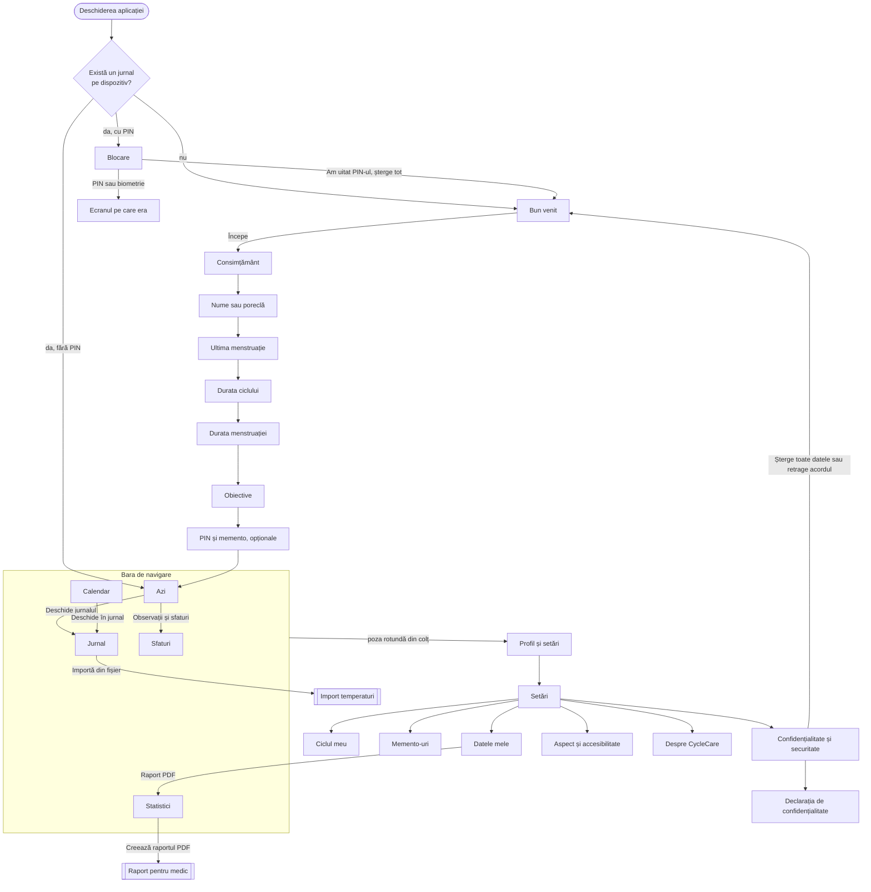

Dreptunghiurile duble sunt ferestre deschise peste ecran (foaie de jos pe telefon, dialog centrat pe ecrane late).

## 3. Prima deschidere

Opt ecrane, dintre care doar consimțământul este obligatoriu. Un indicator „Pasul n din 7” și butonul „Înapoi” sunt prezente de la consimțământ încolo.

| Pas | Ecran | Ce cere | Poate fi sărit | Validare |
|---|---|---|---|---|
| – | Bun venit | Ce face aplicația, pe scurt, butonul „Începe” și, unde se poate, „Instalează aplicația”; jos, celelalte limbi, fiecare scrisă în limba ei („English” / „Română”) | – | – |
| 1 | Consimțământ | Două căsuțe nebifate: prelucrarea datelor privind sănătatea; vârsta de cel puțin 16 ani sau acordul unui părinte. Legătură către declarația de confidențialitate | nu | Fără ambele bife apare o eroare lângă căsuțe. „Nu sunt de acord” explică faptul că nu s-a salvat nimic |
| 2 | Nume sau poreclă | „Cum să-ți spunem?”: un prenume sau o poreclă, cel mult 30 de caractere | da: „Sari peste” | Trebuie să conțină cel puțin o literă, o cifră sau un emoji; mesajul apare sub câmp |
| 3 | Ultima menstruație | Data primei zile (selector nativ de dată, cel mult azi) | da: „Nu-mi amintesc” | Data din viitor este refuzată; o dată mai veche de 90 de zile primește o notă că estimările vor fi nesigure |
| 4 | Durata ciclului | 21–45 de zile, pornind de la 28 | da: „Nu știu” | Valoarea este ținută în interval |
| 5 | Durata menstruației | 2–10 zile, pornind de la 5 | da: „Nu știu” | Valoarea este ținută în interval |
| 6 | Obiective | Contracepție, planificarea unei sarcini, urmărire generală, înțelegerea simptomelor (alegere multiplă) | da: „Sari peste” | La „Contracepție” apare imediat avertismentul că aplicația nu este un mijloc de contracepție |
| 7 | Aproape gata | Opțional: PIN (de două ori) și un memento cu două zile înainte de menstruație | da: „Deschide CycleCare” | PIN de 4–8 cifre, identic în ambele câmpuri |

Pașii se succed cu aceeași mișcare ca restul aplicației: următorul intră din dreapta, iar „Înapoi” îl retrage.

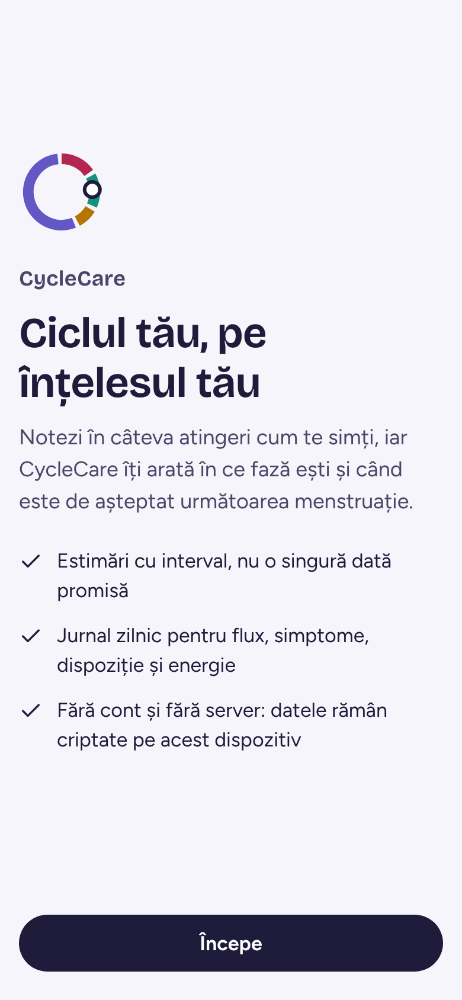
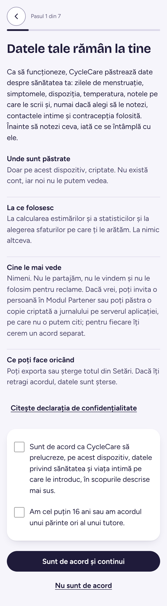
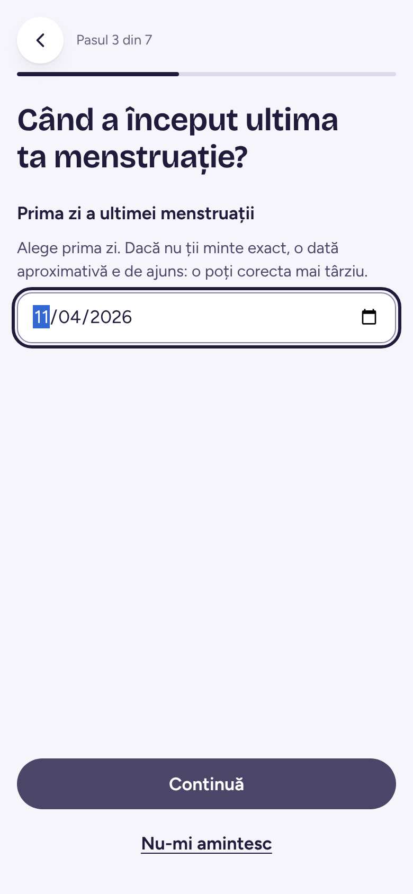
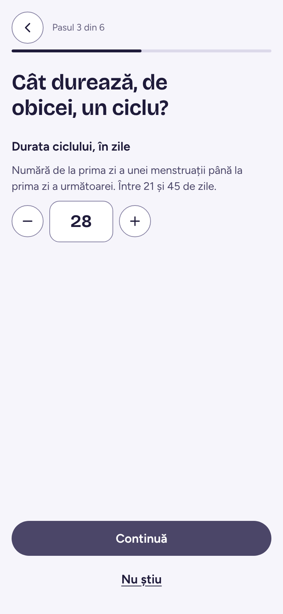
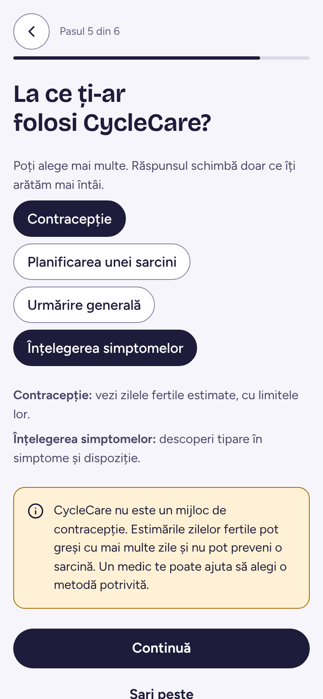
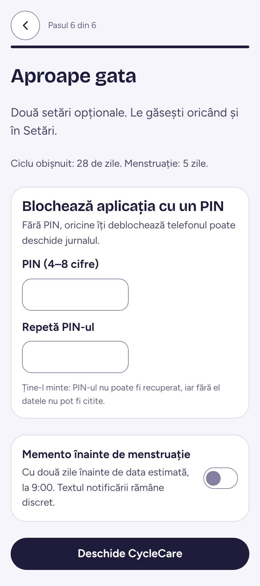

Ce se întâmplă cu răspunsurile:

- data ultimei menstruații devine intrări în jurnal, fără intensitate a fluxului, pentru câte zile durează de obicei menstruația (cel mult până azi);
- duratele declarate sunt punctul de plecare al estimărilor până când există trei cicluri înregistrate (vezi `03-algoritm-predictie.md`);
- obiectivele schimbă doar ordinea: cu „planificarea unei sarcini” fertilitatea apare înaintea următoarei menstruații; cu „înțelegerea simptomelor” observațiile urcă deasupra jurnalului rapid; cu „contracepție” avertismentul scurt este înlocuit de cel explicit.

## 4. Ecranele principale

### 4.1 Azi

Răspunde la „unde sunt în ciclu și ce urmează?”.

1. Antet: titlu, data de azi, în colțul din dreapta sus, poza de profil, care deschide profilul și setările (vezi 4.6). Nu există un buton separat pentru setări.
2. Doar dacă este cazul: anunțul de stocare indisponibilă; invitația „Instalează aplicația” (până la instalare sau până la „Nu acum”).
3. **Cadranul ciclului.** Ziua 1 este sus, sensul este cel al acelor de ceas. Arcele sunt cele patru faze estimate, bila marchează ziua de azi, arcul întrerupt de sus este intervalul în care este așteptată următoarea menstruație, iar arcul punctat din exterior marchează zilele fertile estimate. În centru: „Ziua 12” și faza, cu o capibara ascunsă în spatele cifrei: capul și urechile se ițesc deasupra, cele două lăbuțe (cu gheruțe și o umbră fină pe cifră) se sprijină pe marginea ei de sus, iar corpul se estompează în fundal; clipește, mișcă din ureche și bate ușor dintr-o lăbuță. Dedesubt, legenda cu zilele fiecărei faze.

   **Capibara.** Centrul cercului este un buton. La atingere se întoarce ca o carte (rotire 3D de 0,7 s; instantaneu la „Reducere mișcare”) și pe spate apare capibara întreagă, pe un fond în culoarea fazei. Cam o secundă după ce s-a întors, lângă capul ei apare o bulă de gând, cu trei cerculețe care urcă de la cap spre bulă; gândul e ales după fază dintr-o listă de patru (de exemplu „Oare merită o ciocolată azi? 🍫” la ovulație), iar fiecare întoarcere aduce următorul. Apăsând pe gând, aceasta devine un câmp în care poți scrie propriul gând (cel mult 40 de caractere); „Salvează ✓” sau Enter îl păstrează pe acest dispozitiv, Escape renunță, iar „Gânduri implicite” îl șterge. Cât scrii, cercul nu se mai întoarce singur, iar capibara se estompează ca să se vadă câmpul. Gândul personal rămâne și după repornirea aplicației, până îl ștergi. Ipostaza urmează faza: cu o cană aburindă la menstruație, cu brațele sus și steluțe în faza foliculară, veselă, cu o floare pe cap și stele, la ovulație, învelită într-o pătură pufoasă în faza luteală; când nu e nicio fază de arătat (fără ciclu, estimări oprite, menstruație întârziată), face cu mâna, cu un yuzu pe cap. Cercul se întoarce la a doua atingere sau singur după 9 secunde (nu cât scrii). Pentru cititoarele de ecran butonul se numește după fața vizibilă („Ziua 12, Faza foliculară. Arată capibara”, apoi mesajul și „Înapoi la ziua ciclului”), iar mesajul este și anunțat. Desenul este un SVG din aplicație, cu volum (gradienți radiali în tonuri de caramel, ciocolatiu și crem, o textură fină de blană, umbre moi, ochi lucioși cu reflexii), colorat din paleta ei (`--capy-*` și culorile fazelor), în ambele teme (`src/ui/Capybara.tsx`). Nu încarcă nimic din afară.
4. **Următoarea menstruație**: intervalul („Probabil între 29 noiembrie și 5 decembrie”), data cea mai probabilă, peste câte zile, precizia estimării și pe ce se bazează.
5. **Fertilitate**: zilele fertile și ovulația estimate, cu avertismentul de contracepție. Lipsește dacă estimările de fertilitate sunt oprite.
6. **Risc de sarcină** („Șansa de sarcină” când obiectivul este planificarea unei sarcini): șansa de azi, pe trei trepte, cu motivul; contactele intime din ciclul curent și cel mai mare risc; după un contact cu risc, contracepția de urgență (în primele 5 zile) și ziua din care un test de sarcină este de încredere; mereu, nota că este o estimare, nu o metodă de contracepție. Regulile sunt în `03-algoritm-predictie.md`, secțiunea 8.
7. **Cum e azi?**: fluxul de azi dintr-o atingere, rezumatul a ceea ce s-a notat, buton către jurnal.
8. **Memento-uri azi**, dacă există.
9. **De urmărit**: cel mult două observații, cu legătură către toate.
10. **Un sfat pentru azi**: unul pe zi, pentru faza curentă.

Stări: fără nicio menstruație notată (cadran gol și invitația de a nota prima zi); menstruație așteptată („poate începe în orice zi”); menstruație întârziată (numărul de zile și trimitere către sfaturi).

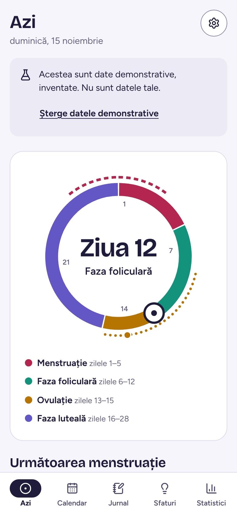
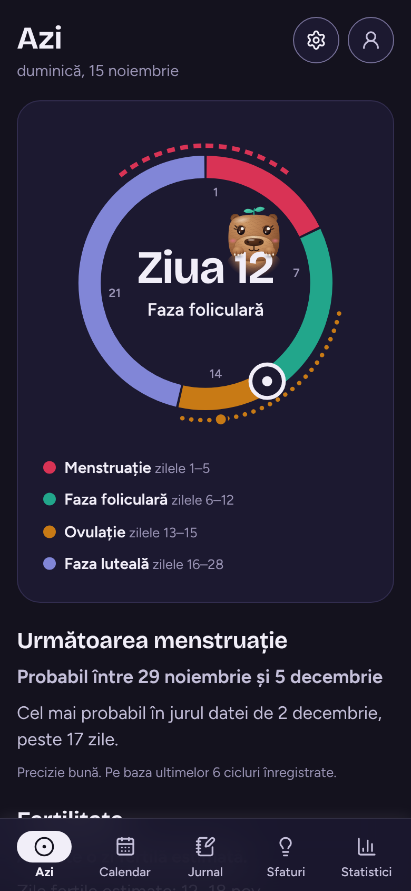

### 4.2 Calendar

1. Navigare pe luni (săgeți, „Înapoi la azi”).
2. **Grila lunii**, cu săptămâna începând lunea. Fiecare fază este o bandă colorată, cu o linie în culoarea fazei dedesubt. Semne: cerc plin pentru menstruație notată, cerc întrerupt pentru menstruație estimată, inel dublu pentru ovulația estimată, punct pentru zi fertilă estimată, romb pentru spotting sau sângerare între menstruații, pătrat pentru o zi cu notițe; ziua de azi este subliniată.
3. **Detaliile zilei selectate**: ziua ciclului, faza, ce este estimat, ce s-a notat, riscul de sarcină pentru un contact intim notat, buton către jurnal. Zilele viitoare arată doar estimări.
   Zilele cu un contact intim au o **inimioară** printre semnele de sub număr. Inimioara are culoarea textului, nu o culoare de fază, și poate fi ascunsă din „Confidențialitate și securitate → Discreție”.
4. **Editarea zilelor de menstruație**: un mod în care atingerea unei zile trecute o marchează sau o demarchează, pentru completarea rapidă a istoricului.
5. Legenda și avertismentul de contracepție.

Estimările apar pentru ciclul curent și pentru următoarele trei; dincolo de ele grila rămâne neutră.

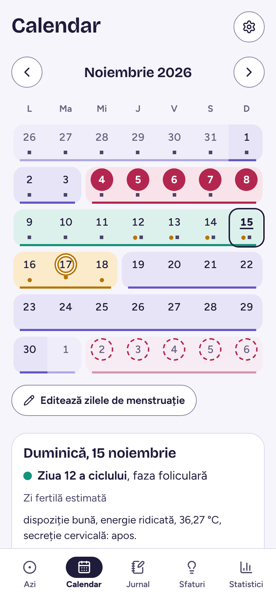
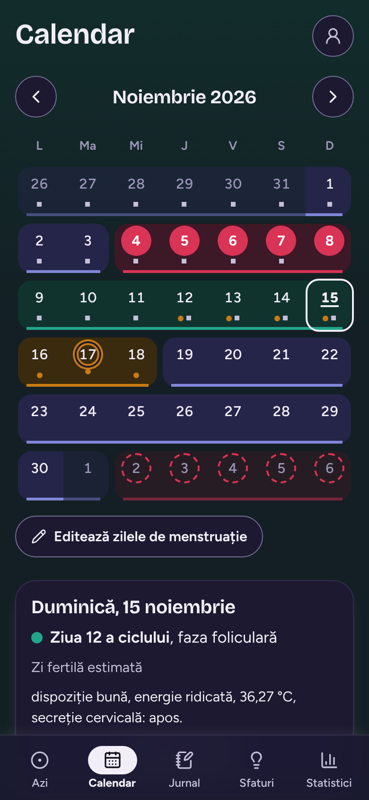

### 4.3 Jurnal

O zi pe ecran, aleasă dintr-o bandă cu zilele săptămânii. Zilele viitoare nu pot fi alese.

| Secțiune | Control | Valori |
|---|---|---|
| Flux | alegere unică, care se poate goli | spotting, ușor, mediu, abundent |
| Simptome | alegere multiplă, pe cinci grupe; apoi intensitatea fiecărui simptom ales | 17 simptome; ușor, moderat, sever |
| Dispoziție | scală cu cinci trepte | foarte scăzută … foarte bună |
| Energie | scală cu cinci trepte | foarte scăzută … foarte ridicată |
| Temperatură bazală | câmp numeric și „Importă din fișier” | 34–42 °C, cu două zecimale |
| Secreție cervicală | alegere unică | uscat, lipicios, cremos, apos, albuș de ou |
| Viață intimă | comutator „Am avut un contact intim”, apoi alegere multiplă pentru felul contactului și pentru contracepție; „Prezervativul s-a rupt sau a alunecat” | penetrare vaginală, sex oral, sex anal, jucării sexuale; prezervativ, pilulă, sterilet, altă metodă hormonală, retragere, fără protecție, pilula de urgență |
| Notă | text liber | până la 2000 de caractere |

Fiecare alegere se păstrează pe loc, iar sub dată apare „Salvat”, așa că nimic nu se pierde dacă pagina este părăsită. În plus, cât timp o secțiune este deschisă, butonul **„Salvare”** stă fixat jos, deasupra barei de file, și ajunge la capătul listei când derulezi până acolo. La apăsare:

1. modificările sunt scrise imediat pe dispozitiv, butonul devine „Salvat ✓” și apare mesajul „Salvat ✓”;
2. după o clipă toate secțiunile se restrâng într-un **rezumat**: titlul secțiunii, alegerile ca etichete mici (de exemplu „Crampe · sever”, „Mediu”, „36,55 °C”), primele rânduri ale notei sau „Nimic notat”; pagina revine sus;
3. fiecare secțiune restrânsă are un buton mic **„Editează”** (sau „Adaugă”, dacă e goală) care o redeschide doar pe ea și mută focusul pe primul ei control.

O zi care are deja ceva notat se deschide direct ca rezumat; o zi goală se deschide cu toate secțiunile. O temperatură care nu poate fi păstrată (de exemplu 50) oprește restrângerea: câmpul rămâne deschis, cu mesajul lângă el.

Sub detaliile unui contact intim apare riscul de sarcină pentru acel contact și motivul (de exemplu „Risc de sarcină: scăzut. Prezervativul folosit corect reduce mult riscul.”). Oprirea comutatorului șterge contactul, cu „Anulează” în mesajul de confirmare. Contactele intime nu apar în raportul PDF.

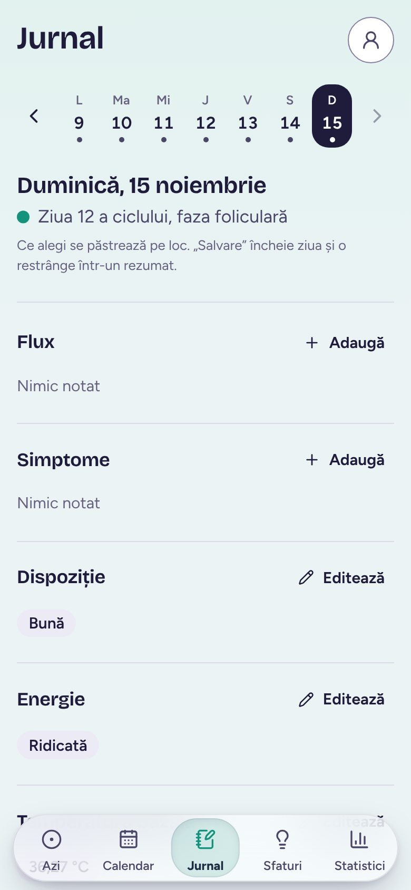

### 4.4 Sfaturi

1. **De urmărit**: observațiile active, fiecare cu „Am înțeles” (o ascunde 30 de zile).
2. **Pentru faza în care ești**: faza curentă este preselectată și marcată „acum”; celelalte pot fi răsfoite.
   - Un card în culoarea fazei cu rezumatul ei și butonul extensibil **„De ce se întâmplă asta?”**, care explică pe scurt ce fac hormonii în acea fază.
   - Patru teme (alimentație, mișcare, somn, piele), fiecare cu 7 sfaturi. Se văd câte **3 carduri**, alese după ziua ciclului, deci altele în fiecare zi; **„Alte idei ↻”** arată imediat următoarele trei.
   - Fiecare card are tema (cu pictogramă), un titlu care spune ce faci, textul, **„De ce ajută?”** (legătura cu hormonii, închisă până la apăsare) și **„Am aplicat ✓”**, care marchează cardul pentru ziua de azi; o a doua apăsare anulează marcajul.
3. **Pentru ce ai notat recent**: câte o fișă pentru fiecare simptom notat de curând, cu „Ce poate ajuta” și „Când merită să ceri sfatul unui medic”.
4. Mențiunea că sfaturile sunt informații generale.

Conținutul și regulile de declanșare sunt în `04-sablon-continut-sfaturi.md`.

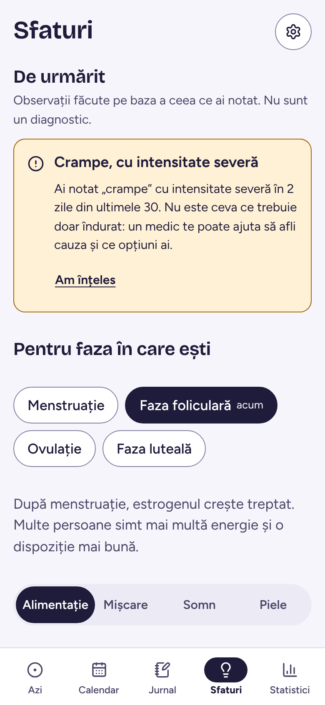

### 4.5 Statistici

1. Patru cifre: ciclul mediu, variația, durata medie a menstruației, cicluri înregistrate.
2. **Durata ciclurilor**: coloane pentru ultimele cicluri încheiate, cu zilele de menstruație la bază.
3. **Simptome pe luni**: un tabel în care nuanța celulei urmează numărul de zile.
4. **Dispoziție și energie**: medii săptămânale pe șase luni, cu menstruațiile ca benzi în fundal; apoi mediile pe faze.
5. **Temperatură bazală**: ultimele 45 de zile, dacă există măsurători.
6. **Raport pentru medic**: deschide fereastra de export PDF.

Fiecare grafic are și varianta „Vezi datele ca tabel”, iar valorile pot fi parcurse cu săgețile de la tastatură.

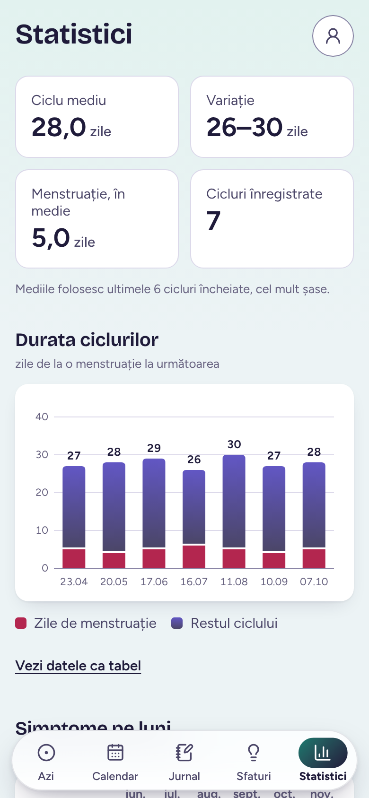
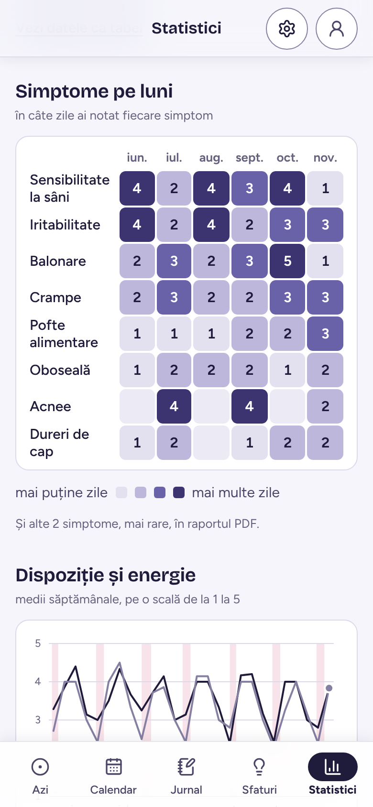
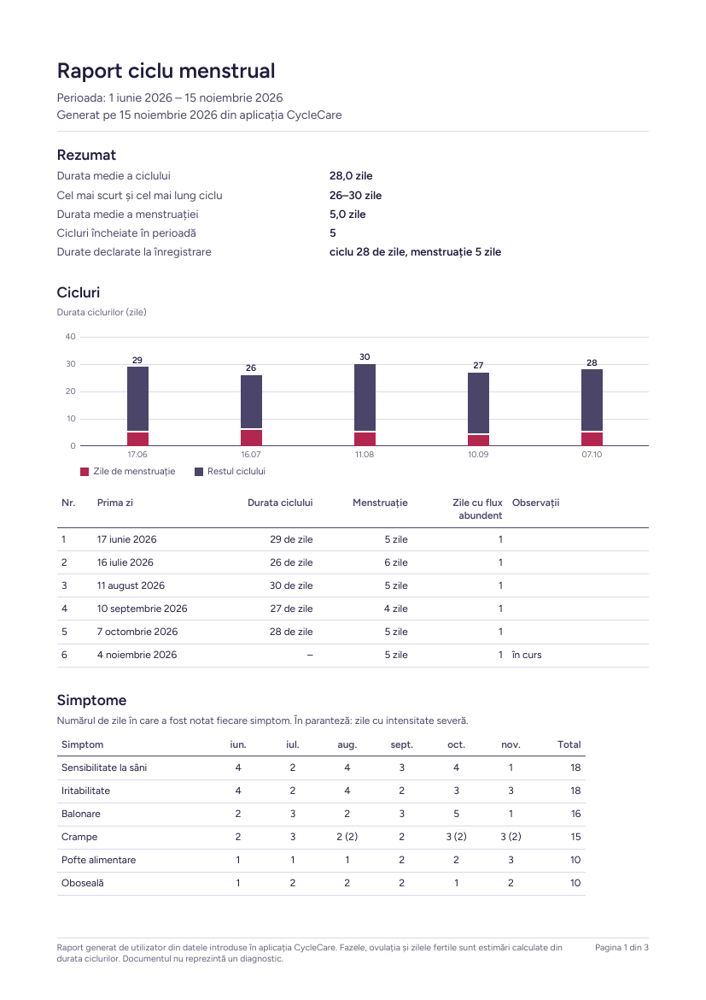

### 4.6 Profil și setări

Se deschide din poza mică și rotundă din colțul din dreapta sus al fiecărei file; este singurul buton de acolo, iar setările sunt chiar pe acest ecran (secțiunea 5). Poza arată fotografia aleasă, inițialele numelui (de exemplu „AM” pentru „Ana Maria”) sau, fără nume, o siluetă neutră.

1. Poza mare, numele (sau „Fără nume”), „Adaugă o poză” / „Schimbă poza” și „Elimină poza” (cu „Anulează” în mesajul de confirmare).
2. Câmpul „Nume sau poreclă”, cu „Salvează”. Golit și salvat, numele este șters.
3. Secțiunea „Setări”: lista ecranelor din secțiunea 5, direct sub nume. Un link vechi `#setari` duce tot aici.
4. O notă despre confidențialitate: numele și poza rămân criptate pe dispozitiv și nu apar pe ecranul de blocare, în notificări sau în raportul PDF.

Poza aleasă din galerie sau făcută cu camera este decupată pătrat (pe mijloc; la pozele verticale, puțin mai sus, unde este de obicei fața), micșorată la 256 × 256 de pixeli și păstrată ca JPEG; fișierul original nu este păstrat. Un fișier care nu este imagine sau mai mare de 25 MB primește un mesaj sub buton.

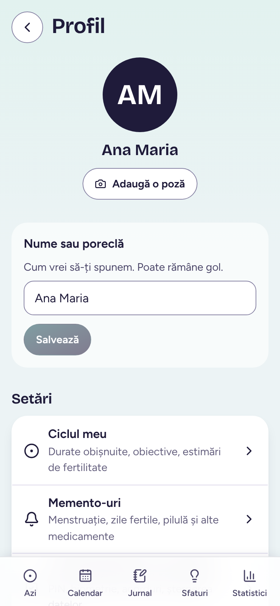
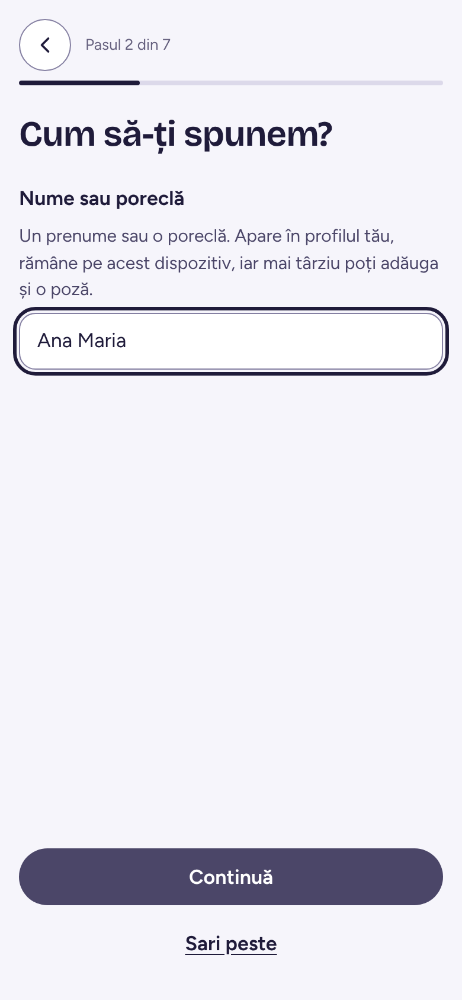

## 5. Setări

Lista lor stă pe ecranul Profil (4.6). Pe telefonul partenerului nu există profil: acolo rămâne un buton cu rotița, care deschide setările lui.

| Ecran | Conținut |
|---|---|
| Ciclul meu | Duratele obișnuite (sau „Nu știu”), obiectivele, comutatorul „Arată fazele ciclului și estimările de fertilitate” |
| Memento-uri | Starea permisiunii de notificare; text discret; începutul menstruației estimate și zilele fertile (cu câte zile înainte, ora, repetare zilnică); pilulă și alte medicamente (denumire, oră, în fiecare zi sau în anumite zile) |
| Confidențialitate și securitate | PIN (setare, schimbare, dezactivare), deblocare biometrică, blocare automată, „Blochează acum”; discreție (inimioarele din calendar); unde sunt datele; partajarea cu terți (ce se partajează prin Modul Partener, cu legătură către Setări → Partener); acordul dat și retragerea lui; declarația de confidențialitate; ștergerea tuturor datelor |
| Partener | Ce poate vedea partenerul, invitația și oprirea partajării (secțiunea 5.1) |
| Copie de siguranță | Codul de recuperare, fișierul criptat și copia automată pe server (secțiunea 5.2) |
| Datele mele | Raportul PDF; exportul și restaurarea unei copii JSON; importul de temperaturi și istoricul importurilor |
| Aspect și accesibilitate | Tema (ca dispozitivul, luminoasă, întunecată), dimensiunea textului (patru trepte), limba (română sau engleză; la prima pornire, limba telefonului) |
| Despre CycleCare | Versiunea, limitele aplicației, instalarea pe ecranul principal, actualizarea la o versiune nouă, licențe |

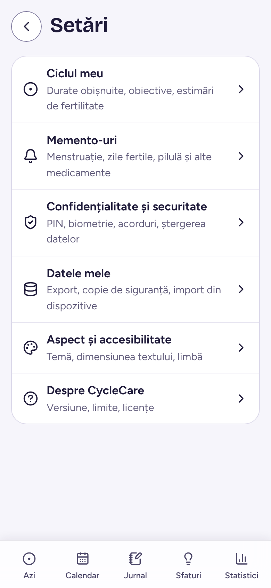
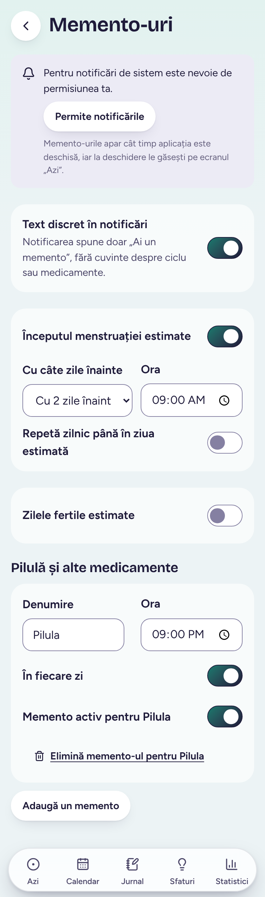
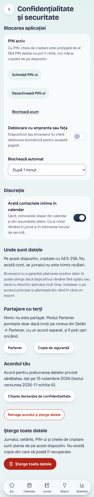
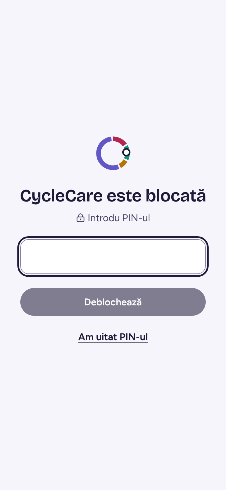

### 5.1 Modul Partener

**Pe telefonul proprietarei, Setări → Partener.** Bifele „Ce poate vedea partenerul” (faza curentă; calendarul și estimările; cum te simți; notițele personale, doar împreună cu „cum te simți”), toate pornite la început, și nota cu ce nu este trimis niciodată (contactele intime, temperatura, secreția cervicală, poza de profil). „Invită partenerul” cere întâi un acord separat, apoi afișează codul de 6 caractere, timpul rămas (10 minute) și „Trimite linkul”. Când partenerul introduce codul, apar cele 6 cifre de verificare, cu „Aprob” și „Nu sunt aceleași”. După conectare: data conectării, starea sincronizării („Ultima actualizare trimisă: acum”, „Fără internet: actualizarea pleacă de îndată ce revii online”), bifele și „Oprește partajarea”, cu confirmare. Unde aplicația nu are server (GitHub Pages), ecranul spune doar că modul nu este disponibil.

**Pe telefonul partenerului.** Primul ecran are și „Conectează-te ca partener”: codul (sau linkul de invitație, care îl completează), apoi cele 6 cifre de arătat. După aprobare, aplicația are trei file, doar pentru citire:

| Filă | Conținut |
|---|---|
| Azi | Faza și ziua ciclului, peste câte zile este așteptată menstruația (cu intervalul), „Cum se simte azi” (flux, simptome, dispoziție, energie, nota zilei), „Cum poți ajuta” (două sfaturi pentru faza curentă, cu „Alte idei ↻”) |
| Calendar | Luna, cu fazele, menstruația notată și estimată, zilele fertile; detaliile zilei alese |
| Istoric | Zilele notate din ultimele 14, cu etichete și note, după permisiuni |

Sus, pe fiecare filă: „Actualizat acum” și „Actualizează”; fără internet, momentul ultimei actualizări primite; după oprirea partajării, „Partajarea a fost oprită”. Ce nu este împărtășit apare ca atare („Jurnalul nu este împărtășit.”). Avatarul din colț deschide setările partenerului: conexiunea și „Deconectează-te” (care șterge tot de pe telefonul lui), PIN, aspect, despre.

### 5.2 Copia de siguranță

**Setări → Copie de siguranță** (și un rând scurt în Setări → Datele mele). Ecranul are patru părți:

1. **Codul de recuperare.** „Creează codul” îl generează pe telefon și îl arată o singură dată, în șase grupe de câte patru caractere, cu „Copiază” și sfatul de a-l nota pe hârtie. Ca să continue, persoana rescrie o grupă cerută din cod; abia atunci codul este considerat notat. După aceea se vede doar „Arată codul” (cu confirmare), „Înlocuiește codul” (copia nouă se creează întâi, cea veche se șterge după) și starea. Codul nu poate fi refăcut: cine îl pierde împreună cu telefonul nu își mai poate deschide copia.
2. **Fișier criptat.** „Salvează un fișier” descarcă `.cyclecare`, criptat cu aceeași cheie, care se poate păstra oriunde. Funcționează și fără server.
3. **Copia automată pe server** (doar unde aplicația are server, adică pe Netlify). Comutatorul cere întâi un acord separat. Apoi aplicația trimite o copie criptată la 45 de secunde după ultima schimbare, la ieșire și la revenire; ecranul arată ultima trimitere, versiunile păstrate (ultima, de ieri, de săptămâna trecută) și, fără internet, că trimiterea pleacă de îndată ce revii online. Dacă alt telefon a scris între timp cu același cod, apare „Altă copie a luat locul” cu alegerea: continuă de aici (înlocuiește copia) sau oprește. „Oprește și șterge copia” o scoate de pe server cu toate versiunile.
4. **Restaurare** („Am deja o copie”, și pe primul ecran, la „Am deja un cont de recuperare”). Codul (litere mici, spații și cratime sunt acceptate) aduce copia de pe server; un fișier `.cyclecare` cere codul, apoi arată data copiei, câte zile conține și un avertisment că înlocuiește ce este pe telefon. Greșelile se spun pe înțelesul persoanei: cod greșit, caracter de control nepotrivit, nicio copie găsită, fără internet, format necunoscut.

La „Am uitat PIN-ul” fereastra spune că o copie de pe server rămâne acolo și poate fi restaurată cu codul după ce se pornește de la zero; „Șterge toate datele” din Setări și retragerea acordului șterg însă și copia de pe server.

## 6. Blocare

Apare la deschidere dacă există un PIN și atunci când aplicația a stat în fundal mai mult decât durata aleasă. Conține câmpul pentru PIN, butonul de deblocare biometrică (dacă este activă) și „Am uitat PIN-ul”, care explică de ce PIN-ul nu poate fi recuperat și oferă ștergerea tuturor datelor. După cinci încercări greșite, introducerea se oprește pentru 30 de secunde, apoi tot mai mult. După deblocare, persoana revine pe ecranul pe care era.

## 7. Ferestre

| Fereastră | De unde se deschide | Ce face |
|---|---|---|
| Declarația de confidențialitate | Consimțământ | Textul complet, fără a părăsi pasul |
| Import temperaturi | Jurnal, Datele mele | Alege fișierul CSV, arată câte valori a găsit, cere confirmarea |
| Raport pentru medic | Statistici | Perioada (3, 6 sau 12 luni), includerea notelor, generarea PDF-ului |
| PIN | Confidențialitate și securitate | Setează, schimbă sau dezactivează PIN-ul |
| Instalează pe iPhone sau iPad | Butonul „Instalează aplicația” (Bun venit, Azi, Despre), pe iOS | Trei pași cu pictograme: Partajare, „Adaugă pe ecranul principal”, „Adaugă”; nota că aplicația instalată își ține datele separat de Safari |
| Confirmări | Ștergere totală, retragerea acordului, restaurare | Un pas explicit înaintea unei acțiuni care nu poate fi anulată |

## 8. Stări speciale

| Situație | Ce se schimbă |
|---|---|
| Nicio menstruație notată | „Azi” invită la prima notare; „Statistici” explică ce va apărea; „Sfaturi” lasă fazele de răsfoit fără una marcată „acum” |
| Menstruație întârziată | Cadranul arată „Menstruația întârzie” și zilele de întârziere ca arc neutru; apare o observație informativă; calendarul desenează doar menstruația așteptată, de azi, fără faze sau zile fertile pentru ciclurile următoare; secțiunea „Fertilitate” spune că estimările sunt suspendate până la notarea următoarei menstruații |
| Estimări de fertilitate oprite | Dispar ovulația, zilele fertile și fazele în afara menstruației, în cadran, calendar, jurnal și raport; rămân zilele de menstruație și estimarea următoarei menstruații |
| Stocare indisponibilă (fereastră privată, fără HTTPS) | Un anunț pe „Azi” spune că datele se păstrează doar până la închiderea paginii; PIN-ul nu poate fi setat fără criptare |
| Versiune nouă disponibilă | Un mesaj cu butonul „Actualizează” și o notă în „Despre”; până la acceptare aplicația rămâne pe versiunea cu care a pornit |
| Eroare neașteptată | Un mesaj scurt; dacă un ecran nu poate fi afișat, doar acel ecran este înlocuit cu o explicație și butonul „Reîncarcă”, iar bara de file rămâne folosibilă |
| Adresă inexistentă | O pagină 404 cu o legătură înapoi în aplicație; o adresă necunoscută din interiorul aplicației duce la „Azi” |
| Seif care nu mai poate fi deschis | Un ecran care explică situația și oferă doar ștergerea datelor |

## 9. Adrese

Fiecare ecran are o adresă simplă, astfel încât butonul „înapoi” al telefonului funcționează, iar un ecran poate fi redeschis direct.

| Adresă | Ecran |
|---|---|
| `#azi` | Azi |
| `#calendar` | Calendar |
| `#jurnal` | Jurnal |
| `#sfaturi` | Sfaturi |
| `#statistici` | Statistici |
| `#profil` | Profil |
| `#setari` | Profil (setările sunt pe același ecran; pe telefonul partenerului, setările lui) |
| `#setari-ciclu`, `#setari-memento`, `#setari-confidentialitate`, `#setari-date`, `#setari-partener`, `#setari-copie`, `#setari-aspect`, `#setari-despre` | Ecranele din Setări |
| `#partener=COD` | Linkul de invitație: deschide conectarea partenerului cu codul completat, apoi adresa revine la `#azi` |
| `#politica` | Declarația de confidențialitate |

Ziua deschisă în jurnal și luna din calendar nu apar în adresă.

## 10. Accesibilitate și adaptare la ecran

- La fiecare schimbare de ecran, focusul trece pe titlu, astfel încât cititorul de ecran anunță noul ecran. La încărcarea paginii, primul element la care ajunge tasta Tab este „Sari la conținut”.
- Toate controalele sunt elemente native (butoane radio, căsuțe, câmpuri), cu etichete; fiecare zi din calendar are o descriere completă, de exemplu „duminică, 15 noiembrie 2026, azi, ziua 12 a ciclului, faza foliculară, zi fertilă estimată, are notițe în jurnal”.
- Calendarul se parcurge cu săgețile; Home și End merg la capetele săptămânii, Page Up și Page Down schimbă luna.
- Fazele nu depind doar de culoare: au nume în legendă, forme diferite pentru semne și poziție în ciclu. Paleta a fost verificată pentru deuteranopie și protanopie.
- Textul are patru trepte și se adaugă peste dimensiunea aleasă în sistem; la treapta cea mai mare, pe un ecran de 320 px, niciun ecran nu derulează lateral.
- Tema întunecată urmează sistemul sau alegerea din setări; animațiile respectă „Reducere mișcare”.
- Verificările automate WCAG 2.2 AA (axe) trec pe toate ecranele, în ambele teme; vezi `e2e/quality.spec.ts`.

## 11. Ce se schimbă într-o aplicație nativă

Structura și fluxul rămân aceleași. Diferă doar ce oferă platforma:

| Aici (web) | Nativ (iOS, Android) |
|---|---|
| Memento-urile apar cât timp aplicația este deschisă și pe ecranul „Azi” | Notificări locale programate în sistem, fără server |
| Import de temperaturi din fișier CSV | Citire din Apple Health sau Health Connect, după permisiunea sistemului |
| PIN verificat de aplicație, cheie păstrată de browser | Cheie în Secure Enclave sau StrongBox, cu limită de încercări impusă de hardware |
| Biometrie prin WebAuthn | Face ID, Touch ID sau biometria Android, direct |
| Raport salvat prin descărcare sau prin foaia de partajare | Foaia de partajare a sistemului |

## 10. Mișcare, gesturi și suprafețe

Aplicația are un cadru fix: fiecare ecran derulează în propriul container, sub o bară de navigare care rămâne sus și deasupra barei de file. Codul este în `src/app/router.ts`, `src/ui/Navigator.tsx`, `src/ui/motion.ts`, `src/ui/swipeBack.ts`, `src/ui/Sheet.tsx`, `src/ui/SwapPanel.tsx`, `src/ui/pop.ts` și, pentru mișcarea din conținutul ecranelor, `src/styles/motion.css`.

| Element | Comportament |
|---|---|
| Intrarea într-un ecran mai adânc (Setări, o secțiune din Setări, declarația) | Ecranul nou intră din dreapta în aproximativ 320 ms, cu o curbă care pornește repede și se așază lin; cel vechi se mută ușor spre stânga și se estompează |
| „Înapoi” | Mișcarea inversă. Ecranul părăsit este eliberat; cel de dedesubt a rămas montat, deci revine exact cum a fost lăsat |
| Glisare de la marginea stângă | Degetul trage ecranul curent, iar cel de dedesubt se vede și îl urmează. Eliberat după o treime din lățime sau cu o mișcare rapidă, gestul se încheie; altfel ecranul revine. O glisare verticală pornită de la margine derulează ca de obicei |
| Schimbarea filei | Ca pe iOS: pagina nouă alunecă dinspre partea în care se află fila aleasă (spre dreapta dacă mergi, de exemplu, de la „Azi” la „Calendar”, spre stânga la întoarcere), cam 42% din lățime, în aproximativ 320 ms, și se limpezește din transparență; cea veche pleacă în sens opus, mai puțin, și se stinge. Peste ambele trece un val de sticlă mată (încețoșare moale și o nuanță a fundalului) care atinge vârful la mijlocul mișcării și se risipește când pagina aterizează; apare doar unde browserul știe încețoșarea și nu apare la „Reducere mișcare”, „Reducere transparență” sau „Contrast mărit” (`src/styles/depth.css`). Filele deja vizitate rămân montate: poziția în pagină, faza și tema alese la „Sfaturi”, luna din calendar se păstrează. O a doua atingere pe fila curentă duce la începutul paginii. Mișcarea: `runPageTransition` și `tabDirection` în `src/ui/motion.ts` |
| Antetul | În repaus este rândul obișnuit: buton, titlu mare, poza de profil (pe telefonul partenerului, rotița). Când pagina derulează, butoanele rămân sus pe o bară de sticlă, titlul mare trece pe sub ea, iar în mijlocul barei apare titlul mic. O atingere pe bară duce la începutul paginii |
| Ferestrele | Pe telefon urcă de la marginea de jos și pot fi trase în jos de antet sau de conținut (când acesta este la început); se închid după un sfert din înălțime sau la o mișcare rapidă, altfel revin cu un mic arc. Escape și atingerea în afara ferestrei le închid la fel. Pe ecrane late sunt dialoguri centrate care se estompează. Stau deasupra tastaturii |
| Culoare după fază | Fundalul paginii ia o nuanță blândă din faza curentă (menstruație, foliculară, ovulație, luteală), cu un luciu mai intens în partea de sus care se stinge spre restul paginii. Nuanța este aceeași pe toate filele. Lipsește când nu există o fază de arătat (fără ciclu, estimări oprite, menstruație întârziată) și pe telefonul partenerului. Culorile (`bg-*`, `glow-*` în `tokens.json`) sunt amestecuri ale culorilor-tint cu fundalul, verificate pentru contrast în ambele teme; `src/app/phaseTint.ts`, `src/styles/depth.css` |
| Adâncime și feluri de carduri | Cardurile se ridică din pagină cu umbre moi, nu cu contur. Trei feluri: **ridicat** (`.card`, `.list`, `.tip-card`: cardul obișnuit), **principal** (`.card-hero`: cercul de pe „Azi”, tintat de fază, cu umbră mai adâncă în culoarea fazei) și **plat** (`.card-flat`: panouri secundare din Setări, Partener, Copie de siguranță, translucide, fără umbră). În tema întunecată, unde umbrele se văd puțin, rămâne un contur discret. La „Contrast mărit” revin conturile și fundalul neutru, iar la culori forțate conturul sistemului |
| Butoane și alegeri umplute | Butoanele secundare, chipurile, treptele de scală și butoanele rotunde din antet nu mai au contur. Pe pagină sunt albe, ridicate de o umbră moale; în interiorul unui card, care e deja alb, sunt o nuanță blândă a culorii fazei. Câmpurile de text și comutatorul își păstrează conturul, pentru că el arată unde sunt. La „Contrast mărit” și la culori forțate conturul revine |
| Bara de file ca în Apple Music | Pe telefon, bara de jos este o pastilă rotunjită de sticlă mată (încețoșare puternică, culori saturate, un fir de lumină sus), desprinsă de margini, cu umbră. Sub fila curentă stă o „lentilă” de sticlă tintată în culoarea fazei, care acoperă iconița și numele; iconița fila curentă ia culoarea fazei, iar numele rămâne în culoarea textului, ca să se citească pe sticlă în orice fază. **La derulare în jos bara se strânge**: restul filelor se micșorează spre cea curentă și se sting, iar bara rămâne un cerc cu doar iconița filei curente, în stânga jos. O mică derulare în sus, o atingere pe cerc, o filă la care ajungi cu tastatura sau întoarcerea sus în pagină o deschid la loc, cu aceeași animație. Atingerea cercului doar deschide bara, nu duce la început de pagină. **Tragerea degetului peste bară** (ca în Apple Music): apeși pe bară și tragi lateral; după vreo 8 px nu mai e o atingere, ci o tragere. Lentila urmărește degetul **fluid**, nu în salturi: ajunge din urmă degetul cadru cu cadru (nu printr-o tranziție relansată la fiecare mișcare, care la o tragere lentă dădea un tremur) și, ca o picătură de apă, se întinde puțin în direcția mișcării cât merge repede, apoi redevine rotundă. Fila aleasă nu se schimbă înapoi și înainte când degetul se odihnește pe linia dintre două file: trebuie să treacă de linie cu o cincime de filă (zonă moartă). Bara se umflă puțin (3,5%), lentila se mărește și are un contur luminos, iar iconița de sub ea se mărește ca printr-o lupă. Fila de sub lentilă arată aleasă (iconița în culoarea fazei, numele îngroșat), iar cea veche se estompează, cu o mică vibrație când lentila trece pe altă filă. **Pagina nu se schimbă cât ții degetul pe bară**: se schimbă abia când îl ridici, la fila de sub lentilă, cu aceeași glisare ca la o atingere, iar lentila alunecă lin pe ea. Dacă ridici degetul peste fila de la care ai pornit, nu se întâmplă nimic. O tragere adaugă o singură intrare în istoric (înapoi duce la fila de la care ai pornit), iar ridicarea nu e luată drept atingere a filei de sub deget. Un gest anulat de sistem nu duce nicăieri. Bara restrânsă nu se poate trage, doar se deschide. `onPointer*` în `src/ui/Shell.tsx` |
| Cardurile din „Azi” | Sub cerc, „Următoarea menstruație”, „Fertilitate”, „Risc de sarcină” și sfatul zilei sunt carduri cu o insignă rotundă în culoarea subiectului. Zilele până la menstruație apar ca o cifră mare („17 zile”, „azi”, „mâine” sau zilele de întârziere), doar pentru ochi (`aria-hidden`): propozițiile de dedesubt spun același lucru în cuvinte. Fertilitatea arată zilele până la fereastra fertilă, când e cazul. Butonul „Deschide jurnalul” din „Cum e azi?” e principal |
| Grafice cu umplere | Barele pentru durata ciclurilor merg de la violet la ardezie, graficul de temperatură are o zonă fină sub linie, iar cadrele graficelor sunt ridicate ca niște carduri. Identificatorii gradientelor vin din `useId`, deci rămân unici chiar dacă filele rămân montate |
| Calendar | Luna stă pe un card. Benzile fazelor au un gradient fin, iar șinele lor se rotunjesc la capetele unei serii; ziua de azi este un cerc plin (o zi cu semn propriu își păstrează semnul și sublinierea). Șina, semnele și legenda rămân: ele poartă faza și în afară de culoare |
| Stări goale | Fără date, capibara salută în „Statistici” în loc de o simplă linie de text |
| Gradient pe ce este ales | Butonul principal și orice alegere bifată (chip, treaptă, comutator) nu mai sunt o singură culoare: pornesc 45% spre o culoare a fazei curente și se așază în culoarea obișnuită. Culoarea este roșu la menstruație, verde în faza foliculară, **albastru deschis la ovulație** (nu chihlimbarul celorlalte elemente) și violet în faza luteală; fără fază, rămâne culoarea simplă. În tema deschisă merge de la o culoare mai închisă spre bleumarin, în cea întunecată de la una deschisă spre lavandă. Contrastul textului cu cel mai luminos capăt e verificat pentru fiecare fază, în ambele teme (`tests/tokens.test.ts`); la „Contrast mărit” și la culori forțate gradientul dispare. `--ink-gradient` și `--grad-c` în `src/styles/depth.css`, tokenul `sky` în `tokens.json` |
| Lentila filei curente alunecă | Evidențierea filei curente este una singură, în spatele iconițelor, care alunecă lin (0,4 s, fără să depășească poziția și să se întoarcă, ca în Apple Music) spre fila aleasă. Arată ca **o picătură de sticlă transparentă**: aproape nimic la mijloc, ca să se vadă iconița și ce e în spatele barei, un reflex luminos sus în stânga, o nuanță slabă a culorii fazei adunată jos în dreapta, un contur luminos și o umbră interioară. Se așază după poziția măsurată a filei (`src/ui/Shell.tsx`), deci e corectă și în pastila de jos, și în coloana din stânga de pe ecrane late; fără mișcare sare direct |
| Inel de progres | Pe cardul „Următoarea menstruație”, insigna are în jur un inel umplut cât a trecut din ciclu (ziua curentă din lungimea estimată). Se desenează cu aceeași animație ca cercul de pe „Azi”; este doar decor (`aria-hidden`), faptele sunt în cifră și în propoziții |
| Simțul de aplicație nativă | Pe telefon, o apăsare lungă sau o tragere peste interfață nu selectează text și nu deschide meniul „Copiază” al browserului (`user-select: none`, `-webkit-touch-callout: none`, iar pe Android oprirea evenimentului `contextmenu` pentru degete, nu pentru mouse). Rămân selectabile câmpurile în care se scrie, codul de recuperare (care trebuie copiat) și declarația de confidențialitate (`.selectable`); `src/ui/native.ts`, `src/styles/base.css` |
| Sticlă | Bara de navigare (după derulare), bara de file, ferestrele și mesajele scurte lasă să se vadă, estompat, ce este dedesubt. Culorile sunt aceleași; fără suport pentru estompare, sau cu „Reducere transparență” ori „Contrast mărit”, suprafețele sunt opace |
| Apăsarea | Butoanele, pastilele și zilele se micșorează ușor (aproximativ 0,97; cele mici ceva mai mult) și revin cu un arc; rândurile de listă se evidențiază. Cardurile și blocurile de pe „Azi” (următoarea menstruație, fertilitate, risc de sarcină, cum e azi, sfatul zilei), centrul cercului, „De ce ajută?” și butoanele capibarei se micșorează mai discret (0,985, respectiv 0,97) |
| Vibrație scurtă | La comutatoare, la notarea menstruației, la PIN corect sau greșit, la confirmări și la „Anulează”, acolo unde dispozitivul o permite |
| Apariția în trepte | La prima afișare a unui ecran și de fiecare dată când o filă îl aduce înapoi, blocurile lui sosesc pe rând, la 60 ms distanță (cel mult opt trepte, deci un ecran lung nu așteaptă): fiecare urcă 12 px și se arată, iar cardurile din interiorul „Azi” și al Calendarului sosesc separat. „Înapoi” sau o glisare nu o reiau. O listă de sfaturi nouă sosește la fel, iar o altă lună intră din partea în care se află |
| „Azi”: cercul | Arcele fazelor se desenează pe rând, de la menstruație spre faza luteală (aproximativ 1,6 s în total), iar în jurul bilei zilei pornește un inel moale care pulsează spre exterior, cât timp ecranul e afișat |
| Calendar | Inelul zilei alese apare cu un arc elastic (de la jumătate de mărime, cu depășire). Detaliile zilei se schimbă cu o estompare și o urcare ușoară, iar panoul trece lin de la înălțimea veche la cea nouă, fără salt |
| Jurnal | Un simptom, o dispoziție sau o intensitate bifată „sare” (se micșorează și revine cu un arc), iar pictograma ei salută cu o mică rotire. „Salvare” arată o bifă care se desenează, un halou verde care se extinde și un arc scurt al butonului; etichetele rezumatului se așază pe rând |
| Sfaturi și Statistici | Cardurile de sfaturi urcă pe rând. Barele cresc de la zero la valoare, de la stânga la dreapta; liniile graficelor se trasează, iar punctul de la capăt și valorile apar după ele; celulele hărții simptomelor „sar” în diagonală |
| „Reducere mișcare” | Nimic din cele de mai sus nu se mai animă: ecranele și ferestrele se schimbă pe loc, desenele sunt complete de la început, inelul din jurul bilei rămâne ca un halou liniștit, iar alegerile nu mai „sar” |

**Cum este făcută.** Mișcarea folosește doar `transform` și `opacity`, pe care browserul le rulează pe placa grafică; singura excepție este desenarea arcelor și a liniilor, care mișcă linia întreruptă a unui contur (ieftin la această mărime, o dată, sub o secundă și jumătate). Nu rămâne niciun strat alocat (fără `will-change`, fără filtre), iar singurele animații care se repetă sunt pulsul bilei și mișcările mici ale capibarei, doar cât ecranul lor e afișat. Animațiile de intrare atârnă de semnul `data-reveal`, pus pe ecran cât durează sosirea lui (2,6 s); animațiile din `motion.css` sunt toate sub `prefers-reduced-motion: no-preference`. `tests/motion.test.ts` verifică aceste reguli în CSS (proprietățile animate, condiția, lipsa straturilor), iar `e2e/animations.spec.ts` verifică în browser fiecare animație și varianta cu mișcare redusă.

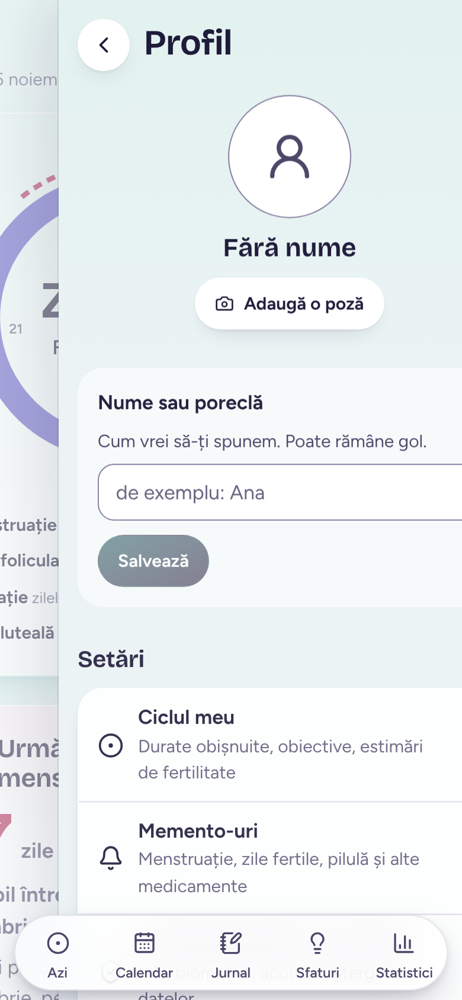
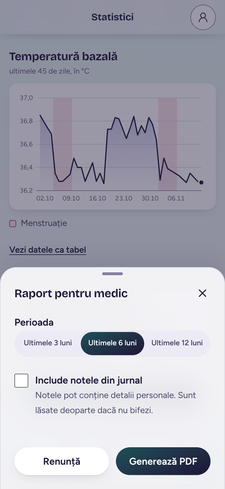

