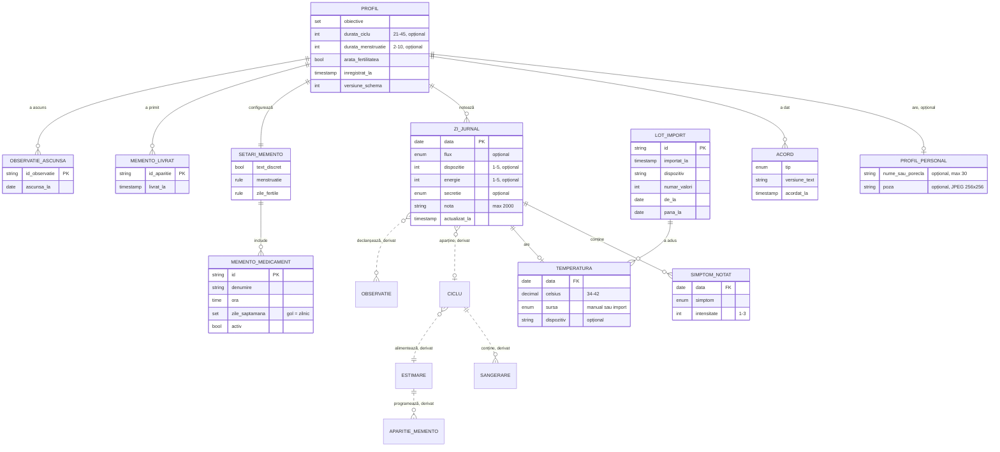
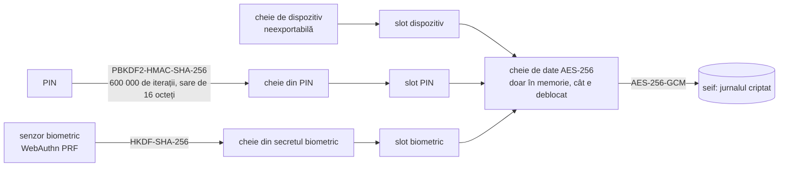
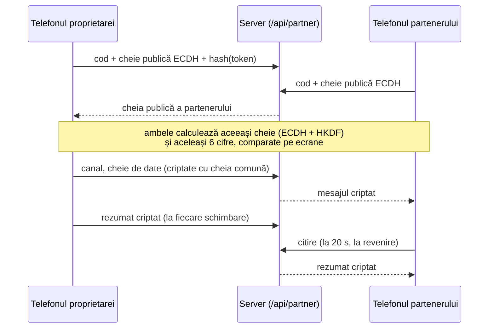

# Modelul de date

Tipurile sunt definite în `src/domain/types.ts`; stocarea este în `src/storage/`. Documentul descrie întâi modelul logic (entități și relații), apoi felul în care aplicația web îl păstrează criptat pe dispozitiv și cum s-ar transpune într-o bază de date relațională pentru aplicația nativă.

## 1. Principii

- **Datele stau doar pe dispozitiv.** Nu există cont, server sau sincronizare. Modelul nu are niciun identificator de persoană: nici nume, nici e-mail, nici identificator de dispozitiv.
- **Se păstrează doar ce introduce persoana.** Ciclurile, fazele, estimările, observațiile și memento-urile programate **nu sunt stocate**: se calculează din jurnal de fiecare dată. Astfel există o singură sursă de adevăr, iar o corectură în jurnal ajustează automat totul.
- **Zilele sunt zile de calendar**, în formatul `AAAA-LL-ZZ`, niciodată momente în timp. Fusul orar și trecerea la ora de vară nu pot muta o înregistrare în altă zi.
- **Minimizare.** Aplicația nu colectează locația, contactele, date de utilizare sau de diagnosticare.

## 2. Entități și relații



Liniile continue leagă entități stocate; liniile punctate arată ce se **derivă** din ele și nu se păstrează.

## 3. Entitățile stocate

### 3.1 Profil

Unul singur pe instalare. Nu identifică persoana.

| Câmp | Tip | Reguli | Rol |
|---|---|---|---|
| `goals` | listă din `contraception`, `conception`, `general`, `symptoms` | poate fi goală | Schimbă ordinea și avertismentele de pe ecranul „Azi” |
| `typicalCycleLength` | întreg, opțional | 21–45 | Durata declarată a ciclului; punct de plecare până există trei cicluri înregistrate |
| `typicalPeriodLength` | întreg, opțional | 2–10 | Durata declarată a menstruației |
| `showFertility` | boolean | implicit `true` | Oprit: se afișează doar menstruația, fără faze estimate și fără fertilitate |
| `showIntimacy` | boolean | implicit `true` | Oprit: inimioarele dispar din calendar și din rezumatele zilelor; contactele rămân în jurnal și în estimarea riscului |
| `onboardedAt` | moment | – | Când s-a încheiat prima configurare |
| `schemaVersion` | întreg | acum `1` | Pentru migrări |

În cod, ultimele trei câmpuri stau pe documentul-rădăcină (`AppData`), alături de profil; logic, descriu aceeași instalare.

### 3.1.1 Profil personal

Opțional. Câmpul `user` din documentul-rădăcină. Este singura parte a datelor care poate identifica persoana, de aceea nu apare pe ecranul de blocare, în notificări sau în raportul PDF.

| Câmp | Tip | Reguli | Rol |
|---|---|---|---|
| `nickname` | text, opțional | cel mult 30 de caractere, cu spațiile curățate; cel puțin o literă, o cifră sau un emoji | Apare în profil și ca inițiale în poza din colț |
| `photo` | text, opțional | `data:image/jpeg;base64,…`, 256 × 256 px, de obicei 20–40 kB; la restaurare se acceptă doar imagini JPEG, PNG sau WebP încorporate, de cel mult 400 kB | Poza de profil |

La restaurarea unei copii care nu are profil personal (de exemplu, una mai veche), numele și poza de pe dispozitiv rămân.

### 3.1.2 Modul Partener

Pe telefonul proprietarei, câmpul `partner` din documentul-rădăcină:

| Câmp | Tip | Rol |
|---|---|---|
| `permissions` | `phase`, `calendar`, `journal`, `notes` (boolean, toate `true` la început) | Ce intră în rezumatul partajat; `notes` contează doar împreună cu `journal` |
| `share` | `channelId` (128 de biți), `dataKey` (AES-256), `writeToken` (256 de biți), `connectedAt` | Legătura activă; nu intră în copia de siguranță JSON |
| `pendingRevoke` | `channelId`, `writeToken` | O legătură oprită fără internet, a cărei copie de pe server mai trebuie ștearsă |

Pe telefonul partenerului, `role` este `partner`, iar `partnerView` ține `channelId`, `dataKey`, `connectedAt`, ultimul rezumat primit (`snapshot`, validat la citire), `etag`, `checkedAt` și `revoked`. Jurnalul acestui telefon rămâne gol.

**Rezumatul partajat** (`src/domain/partner.ts`) este calculat pe telefonul proprietarei. Conține numele (dacă există) și permisiunile, apoi, după bife: faza curentă, ziua ciclului, starea estimării și intervalul următoarei menstruații (`phase`); zilele de la −42 la +84, cu faza, menstruația notată sau estimată, zilele fertile și ovulația (`calendar`, fără fertilitate dacă estimările sunt oprite); ultimele 14 zile cu flux, simptome, dispoziție, energie și, cu `notes`, nota (`journal`). Nu conține niciodată contactele intime, temperatura, secreția cervicală sau poza.

**Pe server** (`server/relay.ts`, în Netlify Blobs): asocierea în curs (codul, cheile publice, hash-ul tokenului proprietarei, mesajul criptat cu datele canalului; expiră după 10 minute) și, pentru fiecare legătură, ultimul rezumat criptat, hash-ul tokenului de scriere și momentul actualizării. Serverul nu primește nicio cheie de decriptare.

### 3.1.3 Copia de siguranță

Câmpul `backup` din documentul-rădăcină (`BackupSettings`), doar în seiful criptat al telefonului:

| Câmp | Tip | Rol |
|---|---|---|
| `code` | 24 de caractere (23 aleatoare și un caracter de control, circa 115 de biți) | Codul de recuperare; din el se derivă tot ce urmează |
| `createdAt`, `confirmed` | moment, boolean | Când a fost creat; dacă persoana a rescris o grupă din cod, ca dovadă că l-a notat |
| `auto` | `since`, `etag`, `digest`, `lastAt`, `taken` | Copia automată pe server este pornită (acord separat); versiunea de pe server scrisă ultima oară, rezumatul a ceea ce s-a trimis, momentul și starea „altă copie a luat locul” |
| `pendingDelete` | listă de `id`, `token` | Copii oprite sau înlocuite de un cod nou, pe care serverul nu a putut fi rugat să le șteargă (fără internet) |

Câmpul `backup` nu intră niciodată în exportul JSON, în fișierul criptat sau în copia de pe server: cine ar avea copia ar avea și cheia ei. Tot așa, `partnerView` și `partner.share` nu sunt incluse.

Din cod, cu HKDF-SHA-256 și etichete diferite, se derivă trei valori: `id` (128 de biți, locul copiei pe server), `token` (256 de biți, dovada dreptului de a citi, scrie și șterge; serverul păstrează doar hash-ul) și cheia AES-256-GCM. Conținutul este JSON-ul portabil al jurnalului, comprimat cu gzip acolo unde browserul poate, apoi sigilat; `id`-ul și felul împachetării sunt legate de criptare (date asociate). Plicul este `{ v: 1, z: 'gzip' | 'none', iv, ct }`; fișierul `.cyclecare` este același plic, cu `app`, `kind` și `savedAt`.

**Pe server** (`/api/partner/backup/<id>`, în Netlify Blobs): hash-ul tokenului și, pentru cel mult trei versiuni (cea mai recentă, una cu cel puțin o zi mai veche, una cu cel puțin o săptămână mai veche), textul criptat, `etag`-ul și momentul. Fiecare cerere, și citirile, cere tokenul. Prima scriere cere `If-None-Match: *`, cele următoare `If-Match: <etag>`; un `412` înseamnă că alt telefon a scris între timp cu același cod. Mărimea unei copii este limitată la 3 000 000 de caractere criptate.

### 3.2 Acord

Dovada consimțământului. Se creează la prima configurare și nu se modifică.

| Câmp | Tip | Reguli |
|---|---|---|
| `type` | `health_data_processing`, `age_confirmation`, `partner_sharing` (proprietara a acceptat Modul Partener), `partner_view` (pe telefonul partenerului), `cloud_backup` (copia criptată pe server) | un rând pentru fiecare acord |
| `textVersion` | text | versiunea textului acceptat (`LEGAL_VERSION`), cu limba: `2026-11-schita-6` în română, `2026-11-draft-6-en` în engleză |
| `grantedAt` | moment | data și ora acordului |

Retragerea acordului șterge toate datele, inclusiv aceste rânduri; nu rămâne nimic de marcat ca „retras”. Acordul `partner_sharing` se dă la prima invitație; oprirea partajării șterge copia de pe server, iar o invitație nouă cere din nou acordul. La fel, acordul `cloud_backup` se dă la pornirea copiei pe server; oprirea ei șterge copia, iar pornirea din nou cere acordul din nou.

### 3.3 Zi de jurnal

Cel mult una pe zi; cheia este data. O zi fără niciun câmp completat este ștearsă, deci jurnalul nu conține zile goale.

| Câmp | Tip | Reguli |
|---|---|---|
| `date` | zi | cheie; nu poate fi în viitor |
| `flow` | `spotting`, `light`, `medium`, `heavy`, `unspecified` | `unspecified` = zi de menstruație fără intensitate (din prima configurare sau din editarea în calendar); `spotting` nu este zi de menstruație |
| `symptoms` | simptom → intensitate | 17 simptome în 5 grupe; intensitate 1 (ușor), 2 (moderat), 3 (sever) |
| `mood` | 1–5 | foarte scăzută … foarte bună |
| `energy` | 1–5 | foarte scăzută … foarte ridicată |
| `bbt` | temperatură | `celsius` 34–42 cu două zecimale; `source` `manual` sau `import`; `device` pentru valorile importate |
| `mucus` | `dry`, `sticky`, `creamy`, `watery`, `eggwhite` | – |
| `intimacy` | contact intim, opțional | `activities`: listă din `vaginal`, `oral`, `anal`, `toys` (poate fi goală); `protection`: listă din `condom`, `pill`, `iud`, `hormonal_other`, `withdrawal`, `none`, `emergency` (poate fi goală); `condomFailed`: adevărat doar împreună cu `condom` |
| `note` | text | cel mult 2000 de caractere |
| `updatedAt` | moment | ultima modificare |

Simptomele: durere (`cramps`, `headache`, `backache`, `breast_tenderness`), digestie (`bloating`, `nausea`, `constipation`, `diarrhea`, `cravings`), piele (`acne`), stare generală (`fatigue`, `insomnia`, `dizziness`), emoții (`irritability`, `anxiety`, `sadness`, `mood_swings`).

### 3.4 Lot de import

Un rând pentru fiecare fișier importat dintr-un dispozitiv purtabil: `id`, `importedAt`, `device`, `count`, `from`, `to`. Valorile aduse sunt temperaturi cu `source = import` și același `device`.

### 3.5 Memento-uri

| Entitate | Câmpuri |
|---|---|
| Setări | `discreet` (textul notificării nu menționează ciclul sau medicamentele; implicit pornit); regulile `period` și `fertile`, fiecare cu `enabled`, `daysBefore` (0–7), `time` (`HH:MM`), `repeatDaily` |
| Memento pentru medicament | `id`, `name`, `time`, `weekdays` (0 = luni … 6 = duminică; listă goală = în fiecare zi), `enabled` |
| Memento livrat | identificatorul apariției → momentul livrării; previne livrarea dublă; rândurile mai vechi de 60 de zile se șterg |

### 3.6 Observație ascunsă

Identificatorul observației → ziua în care persoana a apăsat „Am înțeles”. Observația rămâne ascunsă 30 de zile.

## 4. Ce se derivă și nu se stochează

| Entitate derivată | Din ce | Unde |
|---|---|---|
| Sângerare (`BleedEpisode`) | zilele cu flux de menstruație, grupate | `src/domain/cycles.ts` |
| Ciclu (`Cycle`): început, menstruația care îl deschide, sângerări între menstruații, sfârșit, durată, valid sau nu | sângerări | `src/domain/cycles.ts` |
| Statistici (`CycleStats`): medie mobilă, variabilitate | ciclurile valide din fereastră + duratele declarate | `src/domain/prediction.ts` |
| Estimare (`Prediction`): ciclul curent, intervalul următoarei menstruații, ovulație, zile fertile, trei cicluri viitoare, precizie | statistici + ultima menstruație + ziua de azi | `src/domain/prediction.ts` |
| Informații despre o zi (`DayInfo`): faza, ziua ciclului, ce este estimat | cicluri + estimare | `src/domain/prediction.ts` |
| Observație (`Flag`) și simptom recent | jurnal + cicluri + estimare | `src/domain/insights.ts` |
| Apariție de memento (`ReminderOccurrence`) | setări + estimare | `src/domain/reminders.ts` |
| Agregări pentru grafice și raport | jurnal + cicluri | `src/domain/stats.ts` |

Toate sunt funcții pure: aceleași date de intrare dau același rezultat. Algoritmul este descris în `03-algoritm-predictie.md`.

## 5. Conținutul livrat cu aplicația

Nu sunt date ale persoanei și nu se modifică la folosire: sfaturile pe faze și pe simptome și mesajele observațiilor (`src/content/<limbă>/tips.ts`, cu `TIPS_VERSION`), textele juridice (`src/content/<limbă>/legal.ts`, cu `LEGAL_VERSION`) și textele interfeței (`src/i18n/<limbă>.ts`).

## 6. Cum sunt păstrate datele în aplicația web

### 6.1 Ce se află pe disc

Baza de date IndexedDB `cyclecare` are un singur depozit cu trei chei:

| Cheie | Conținut | Criptat |
|---|---|---|
| `vault` | Tot modelul din secțiunea 3, ca un singur document JSON criptat cu AES-256-GCM (nonce nou la fiecare salvare) | da |
| `meta` | Versiunea seifului, data creării, „sloturile de chei” (cheia de date împachetată, săruri, număr de iterații), contorul de PIN-uri greșite și pauza curentă | nu conține date despre sănătate |
| `deviceKey` | O cheie AES neexportabilă, păstrată de browser; există doar cât timp nu este setat un PIN | – |

În afara seifului, în `localStorage`, sunt preferințele de afișare (temă, dimensiunea textului, blocarea automată, limba) și, dacă ai scris unul, gândul personal al capibarei de pe ecranul „Azi” (cel mult 40 de caractere). Gândul este text scris de tine și nu este cifrat: nu conține date despre ciclu și nu părăsește dispozitivul, dar, spre deosebire de jurnal, nu este protejat de criptare. Limba este salvată la prima pornire, după limba telefonului; preferințele fără limbă, rămase de la versiunile de dinainte de engleză, înseamnă română. Trebuie citite înainte de deblocare, ca ecranul de blocare să respecte tema și dimensiunea textului.

### 6.2 Ierarhia de chei



- Fără PIN există doar slotul de dispozitiv: datele sunt criptate pe disc, iar cheia nu poate fi exportată de scripturi, dar oricine deschide aplicația pe dispozitivul deblocat le vede.
- La setarea unui PIN, slotul de dispozitiv și cheia de dispozitiv sunt șterse: cheia de date mai poate fi recuperată doar cu PIN-ul sau cu biometria. PIN-ul nu este stocat; un PIN greșit se recunoaște prin faptul că despachetarea eșuează.
- Blocarea șterge din memorie cheia de date și jurnalul decriptat.
- „Șterge toate datele” golește depozitul și `localStorage`.

Limite ale variantei web, de spus deschis: un PIN din cifre are puțină entropie, iar limita de încercări este impusă de aplicație, nu de hardware. Aplicația nativă trebuie să țină cheia în Secure Enclave (iOS) sau StrongBox (Android), unde limita de încercări este impusă de cip.

### 6.3 Criptarea în tranzit

Jurnalul nu este transmis nicăieri, iar politica de securitate a paginii (`connect-src 'self'`) blochează orice cerere către alt server. Singura excepție este Modul Partener, pornit doar cu acord separat: rezumatul este criptat pe telefon (AES-256-GCM, cu identificatorul canalului ca date asociate) cu o cheie pe care serverul nu o are și trimis prin HTTPS pe același domeniu.



Un intermediar care ar înlocui cheile publice ar obține alte cifre de verificare; de aceea proprietara aprobă abia după ce le compară. Codul expiră după 10 minute, iar primul telefon care îl folosește îl blochează pentru oricine altcineva.

## 7. Export și restaurare

| Format | Conținut | Unde se creează |
|---|---|---|
| PDF | Raportul pentru medic, pe 3, 6 sau 12 luni; notele doar la cerere | pe dispozitiv, `src/pdf/` |
| JSON | `{ app: "CycleCare", format: 1, exportedAt, data }`, unde `data` este modelul din secțiunea 3 | pe dispozitiv, `src/storage/backup.ts` |

Fișierul JSON nu este criptat, iar aplicația spune asta înainte de salvare. La restaurare, fișierul este tratat ca dată nesigură: fiecare câmp este validat, valorile necunoscute sau în afara limitelor sunt ignorate, iar acordurile de pe dispozitiv se păstrează (nu se importă acordul dat pe alt dispozitiv).

## 8. Ciclul de viață al datelor

| Moment | Ce se întâmplă |
|---|---|
| Consimțământ | Se creează seiful, cu profilul și cele două acorduri |
| Folosire | Fiecare schimbare actualizează documentul criptat, la cel mult un sfert de secundă după ultima atingere și înainte ca pagina să treacă în fundal |
| Export | Persoana salvează un fișier pe dispozitivul ei; aplicația nu păstrează o copie |
| Modul Partener | Rezumatul criptat este înlocuit pe server la fiecare schimbare și șters la oprirea partajării; asocierile neterminate expiră după 10 minute |
| Ștergere sau retragerea acordului | Seiful, cheile și preferințele sunt șterse; o partajare activă este oprită și copia ei de pe server ștearsă; nu există copie de rezervă |
| Dezinstalare sau ștergerea datelor site-ului | La fel; datele nu pot fi recuperate |

## 9. Transpunere într-o bază de date relațională

Pentru aplicația nativă, același model se așază într-o bază SQLite criptată (de exemplu SQLCipher), cu cheia în depozitul securizat al sistemului. Schiță:

```sql
CREATE TABLE profile (
  id                    INTEGER PRIMARY KEY CHECK (id = 1),
  typical_cycle_length  INTEGER CHECK (typical_cycle_length BETWEEN 21 AND 45),
  typical_period_length INTEGER CHECK (typical_period_length BETWEEN 2 AND 10),
  show_fertility        INTEGER NOT NULL DEFAULT 1,
  onboarded_at          TEXT,
  schema_version        INTEGER NOT NULL
);
CREATE TABLE user_profile (
  id        INTEGER PRIMARY KEY CHECK (id = 1),
  nickname  TEXT CHECK (length(nickname) <= 30),
  photo     BLOB                                   -- JPEG, 256 × 256
);
CREATE TABLE profile_goal (
  goal TEXT PRIMARY KEY CHECK (goal IN ('contraception', 'conception', 'general', 'symptoms'))
);
CREATE TABLE consent (
  id           INTEGER PRIMARY KEY,
  type         TEXT NOT NULL,
  text_version TEXT NOT NULL,
  granted_at   TEXT NOT NULL,
  withdrawn_at TEXT
);
CREATE TABLE day_log (
  date       TEXT PRIMARY KEY,                 -- AAAA-LL-ZZ
  flow       TEXT CHECK (flow IN ('spotting', 'light', 'medium', 'heavy', 'unspecified')),
  mood       INTEGER CHECK (mood BETWEEN 1 AND 5),
  energy     INTEGER CHECK (energy BETWEEN 1 AND 5),
  mucus      TEXT CHECK (mucus IN ('dry', 'sticky', 'creamy', 'watery', 'eggwhite')),
  note       TEXT CHECK (length(note) <= 2000),
  updated_at TEXT NOT NULL
);
CREATE TABLE intimacy_entry (
  date           TEXT PRIMARY KEY REFERENCES day_log(date) ON DELETE CASCADE,
  condom_failed  INTEGER NOT NULL DEFAULT 0
);
CREATE TABLE intimacy_activity (
  date     TEXT NOT NULL REFERENCES intimacy_entry(date) ON DELETE CASCADE,
  activity TEXT NOT NULL CHECK (activity IN ('vaginal', 'oral', 'anal', 'toys')),
  PRIMARY KEY (date, activity)
);
CREATE TABLE intimacy_protection (
  date   TEXT NOT NULL REFERENCES intimacy_entry(date) ON DELETE CASCADE,
  method TEXT NOT NULL CHECK (method IN ('condom', 'pill', 'iud', 'hormonal_other', 'withdrawal', 'none', 'emergency')),
  PRIMARY KEY (date, method)
);
CREATE TABLE symptom_entry (
  date      TEXT NOT NULL REFERENCES day_log(date) ON DELETE CASCADE,
  symptom   TEXT NOT NULL,
  intensity INTEGER NOT NULL CHECK (intensity BETWEEN 1 AND 3),
  PRIMARY KEY (date, symptom)
);
CREATE TABLE import_batch (
  id          TEXT PRIMARY KEY,
  imported_at TEXT NOT NULL,
  device      TEXT NOT NULL,
  count       INTEGER NOT NULL,
  from_date   TEXT NOT NULL,
  to_date     TEXT NOT NULL
);
CREATE TABLE bbt_reading (
  date            TEXT PRIMARY KEY REFERENCES day_log(date) ON DELETE CASCADE,
  celsius         REAL NOT NULL CHECK (celsius BETWEEN 34 AND 42),
  source          TEXT NOT NULL CHECK (source IN ('manual', 'import')),
  import_batch_id TEXT REFERENCES import_batch(id) ON DELETE SET NULL
);
CREATE TABLE reminder_rule (
  kind         TEXT PRIMARY KEY CHECK (kind IN ('period', 'fertile')),
  enabled      INTEGER NOT NULL DEFAULT 0,
  days_before  INTEGER NOT NULL CHECK (days_before BETWEEN 0 AND 7),
  time         TEXT NOT NULL,                  -- HH:MM
  repeat_daily INTEGER NOT NULL DEFAULT 0
);
CREATE TABLE medication_reminder (
  id       TEXT PRIMARY KEY,
  name     TEXT NOT NULL,
  time     TEXT NOT NULL,
  weekdays TEXT NOT NULL DEFAULT '',           -- de ex. '0,3'; gol = zilnic
  enabled  INTEGER NOT NULL DEFAULT 1
);
CREATE TABLE fired_reminder (occurrence_id TEXT PRIMARY KEY, fired_at TEXT NOT NULL);
CREATE TABLE dismissed_flag (flag_id TEXT PRIMARY KEY, dismissed_on TEXT NOT NULL);
```

Ciclurile nu au tabel: se calculează din `day_log`. Dacă volumul o cere, pot fi ținute într-un tabel de lucru reconstruit la fiecare schimbare a fluxului, dar tabelul acela nu este o sursă de adevăr și nu se exportă.

## 10. Versiuni și migrări

`schemaVersion` este `1`. La deschidere, documentul este completat cu valorile implicite ale câmpurilor apărute între timp. O schimbare incompatibilă crește versiunea și adaugă o funcție de migrare de la versiunea anterioară; exporturile JSON poartă propriul număr de format, verificat la restaurare.
